# H1V3-RobotPolicies

<p align="center">
  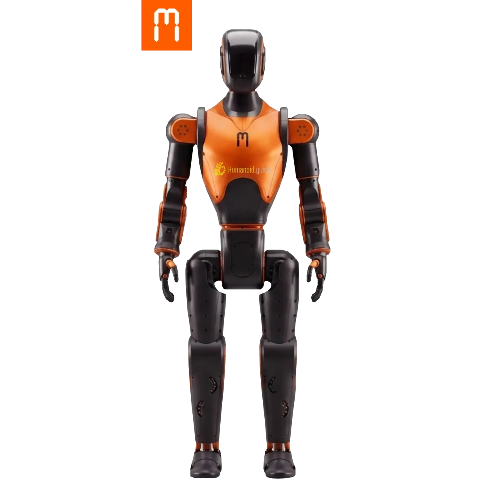
  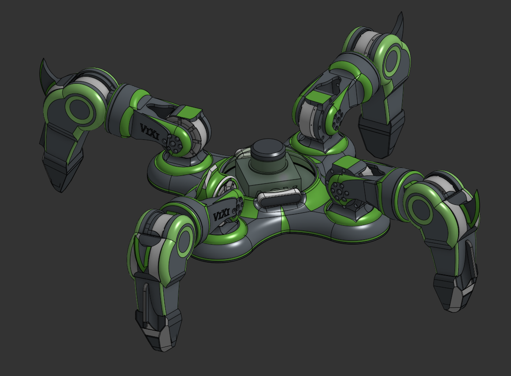
  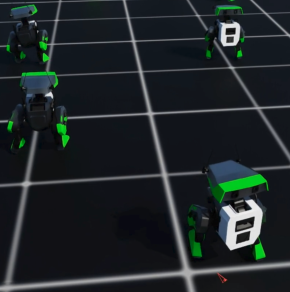
  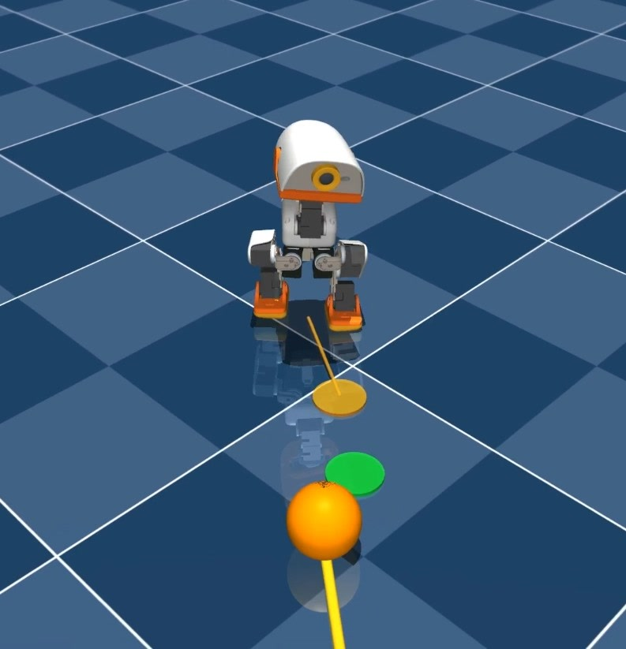
</p>

<p align="center">
  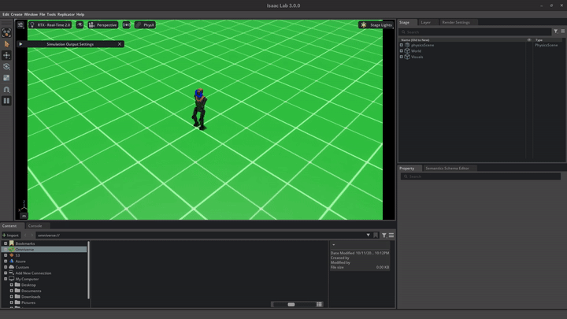
  <br>
  <em>asimov-1 driven live via the ROS2 /cmd_vel teleop bridge in this repo - proof of concept.</em>
</p>

Reinforcement learning locomotion policies for four robots. Three were trained in [NVIDIA Isaac Lab](https://github.com/isaac-sim/IsaacLab), and one (Microduck) in [mjlab](https://github.com/mujocolab/mjlab) (MuJoCo Warp). See [Two training stacks](#two-training-stacks--read-this-first) before using any checkpoint.

- **asimov-1** ([menloresearch/asimov-1](https://github.com/menloresearch/asimov-1)) - a 1.2m/35kg open-source humanoid. Trained with PPO + Adversarial Motion Priors (AMP) for omnidirectional walking (forward/backward/strafe/turn), with a live ROS2 teleop bridge for real-time keyboard control.
- **v1x1** - a custom quadruped. Trained with PPO for omnidirectional walking, also with a live ROS2 teleop bridge.
- **BDX-R** ([BDX-R/BDX-R-IsaacLab](https://github.com/BDX-R/BDX-R-IsaacLab)) - an open-source Disney BDX-droid-inspired biped, hardware target under $3000. Trained with plain PPO for omnidirectional velocity-command walking on flat ground.
- **Microduck** ([pollen-robotics/microduck_rl](https://github.com/pollen-robotics/microduck_rl)) - Pollen Robotics' ~800 g open-source biped. **Trained in mjlab, not Isaac Lab**: one VelStand policy that walks on velocity commands and gets back up after falling, plus a v0 go-to-point waypoint supervisor that drives it, right- and left-foot ball-kick policies with a go-kick-recover mission, and a precision-step policy that places the duck to within ~5 mm for the kick. Sim-validated only.

## Two training stacks — read this first

Policies here come from **two different simulators**. They are not interchangeable: the physics backends, export formats and observation-normalization handling all differ. Every policy in the index below is labeled with the stack it was trained in.

**Isaac Lab (NVIDIA Isaac Sim / PhysX)** - asimov-1, v1x1, BDX-R
- Pinned to Isaac Lab `v3.0.0-beta2.patch1`.
- Checkpoints ship as `<name>.pt` plus a same-named folder with `actor.onnx`, `actor.safetensors`, `full.safetensors` and `metadata.json`. BDX-R currently ships the `.pt` only.
- Observation normalization: check each checkpoint's `metadata.json`. The walking policies trained with normalization OFF. The asimov-1 fall-recovery policies trained with it ON, and their normalizer stats are in `actor.safetensors`. They are **not** baked into `actor.onnx`.

**mjlab (MuJoCo Warp)** - Microduck
- Trained with [pollen-robotics/microduck_rl](https://github.com/pollen-robotics/microduck_rl) (mjlab 1.3.0, PPO via RSL-RL). The full code, all training runs and the eval scripts are in [dillonfaulk/microduck_rl @ local/velstand-own-teachers](https://github.com/dillonfaulk/microduck_rl/tree/local/velstand-own-teachers).
- Policies ship as ONNX exported with that repo's `scripts/export.py`, with the observation normalizer **baked into the ONNX**. Feed raw observations.
- Each policy folder also carries a snapshot of its task config, distillation code and the RSL-RL PPO `agent.yaml` / `env.yaml` the run used.

### Policy index

| Robot | Policy | Checkpoint | Trained in | Contract | Status |
|---|---|---|---|---|---|
| asimov-1 | Omnidirectional walking (PPO+AMP) | `checkpoints/asimov1/asimov1_omni_robustness_validated` | Isaac Lab | 81 obs / 23 actions, 60 Hz | Validated (sim) |
| asimov-1 | Fall recovery (walk→fall→recover→walk handoff 90.0%, 36/40) | `checkpoints/asimov1/asimov1_fallrecovery_stable_validated` | Isaac Lab | 76 obs / 23 actions, 60 Hz, normalizer in safetensors | Validated (sim) |
| v1x1 | Omnidirectional walking (PPO) | `checkpoints/v1x1/v1x1_omni_final` | Isaac Lab | 60 obs / 16 actions | Validated (sim) |
| v1x1 | SV walking (PPO) | `checkpoints/v1x1/v1x1_SVwalk_final` | Isaac Lab | 84 obs / 16 actions | Validated (sim) |
| BDX-R | Velocity walking, flat (PPO) | `checkpoints/bdxr/bdxr_velocity_flat_validated.pt` | Isaac Lab | 39 obs / 10 actions | Validated (sim) |
| Microduck | VelStand: walks AND gets up, one policy | `microduck/velstand/velstand_round3_model_3999.onnx` | **mjlab** | 61 obs / 14 actions, 50 Hz, normalizer baked in | Sim-validated, NOT hardware-tested |
| Microduck | BallKick v1: right-foot kick (ball-blind, swapped in by a mission script) | `microduck/ballkick/ballkick_right_ts0p25_model_1000.onnx` | **mjlab** | 61 obs / 14 actions, 50 Hz, normalizer baked in | Sim-validated, NOT hardware-tested |
| Microduck | BallKick v1: left-foot kick (mirror of the right, own calibrations) | `microduck/ballkick_left/ballkick_left_ts0p25_model_1250.onnx` | **mjlab** | 61 obs / 14 actions, 50 Hz, normalizer baked in | Sim-validated, NOT hardware-tested |
| Microduck | PrecisionStep v1: final-approach step-to-pose (twist slots = remaining target offset) | `microduck/precision_step/precision_step_model_3999.onnx` | **mjlab** | 61 obs / 14 actions, 50 Hz, normalizer baked in | Sim-validated, NOT hardware-tested |

<p align="center">
  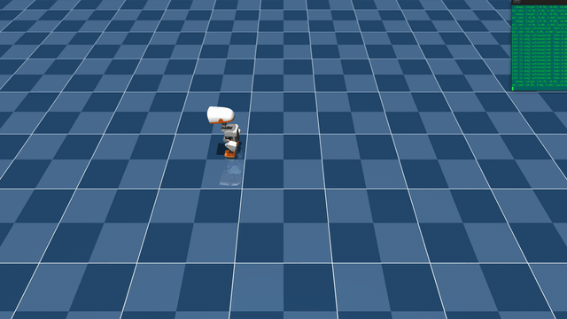
  <br>
  <em>Microduck VelStand driven live by keyboard in the MuJoCo viewer (mjlab-trained, sim only; recorded with the round 2 policy).</em>
</p>

Earlier milestone checkpoints (the asimov-1 omni step3/step4/quality_run2 and the earlier fall-recovery runs) are also in `checkpoints/`; each one's training-status section below explains where it sits in the lineage.

This repo does **not** contain the Isaac Lab framework itself - only the project-specific files (task definitions, reward/termination shaping, robot asset configs, converted USD models, training/play/teleop scripts, and a handful of validated checkpoints) needed to drop back into a fresh Isaac Lab checkout.

**Every validated checkpoint ships in three formats**, so you don't need this repo's Isaac Lab setup just to use a trained policy:
- **`.pt`** - the original RSL-RL training checkpoint (actor + critic + optimizer state). Needed to resume training; also the only format to open with PyTorch directly. Pickle-based, so only ever load one from a source you trust.
- **`.safetensors`** - the same weights with zero code-execution risk on load, split into `actor.safetensors` (deployable policy only) and `full.safetensors` (everything, for inspection/continued training).
- **`.onnx`** - the policy exported as a portable inference graph. Runs in ONNX Runtime, TensorRT, on a Jetson, or anywhere else with no PyTorch or Isaac Lab installed. Self-contained single file, numerically verified against the original PyTorch output at export time.

See [Safetensors and ONNX conversions](#safetensors-and-onnx-conversions) below for exactly what's in each, and how to regenerate them with `tools/convert_checkpoint.py`/`tools/export_onnx.py`.

## Prerequisites

- **Isaac Lab**, checked out at tag **`v3.0.0-beta2.patch1`** (this is the exact version everything here was built and tested against - newer versions may have breaking API changes):
  ```bash
  git clone --branch v3.0.0-beta2.patch1 git@github.com:isaac-sim/IsaacLab.git
  ```
  Follow Isaac Lab's own install instructions to get it running (Isaac Sim + the IsaacLab Python environment).
- **ROS2 Jazzy** (only needed for the teleop bridge scripts):
  ```bash
  sudo apt install ros-jazzy-desktop ros-jazzy-teleop-twist-keyboard
  ```

## Restoring into a fresh Isaac Lab checkout

```bash
# from the root of a fresh IsaacLab clone:
rsync -a /path/to/H1V3-RobotPolicies/isaaclab/ ./
git apply /path/to/H1V3-RobotPolicies/isaaclab/patches/robot_registry_init.patch
```

The patch adds two export lines (`V1X1_CFG`, `ASIMOV1_CFG`) to `isaaclab_assets`'s own `__init__.pyi` stub files so both robots show up alongside Isaac Lab's built-in ones (`ANT_CFG`, etc.). If the patch doesn't apply cleanly against a different Isaac Lab version, just add the two lines by hand - see the patch file for exactly what's needed, it's trivial.

Checkpoints aren't wired into the `isaaclab/` tree (so you can put them wherever you like) - see `checkpoints/` below, and pass their path via `--checkpoint` on any of the play scripts.

**BDX-R restores differently** - unlike asimov-1/v1x1, it's NOT merged into the Isaac Lab checkout itself. It's a separate external project installed as an editable pip package:
```bash
./isaaclab.sh -p -m pip install -e /path/to/H1V3-RobotPolicies/bdxr/source_BDXR
```
Then run its scripts directly from wherever you put `bdxr/scripts_rsl_rl/` (they're self-contained, just need `cli_args.py` alongside `train.py`/`play.py`, same as they ship). See [BDX-R: training status](#bdx-r-training-status) below for the exact fixes/launch commands.

## Repo layout

```
isaaclab/                    # mirrors Isaac Lab's own directory structure exactly
  scripts/reinforcement_learning/rsl_rl/
    train_asimov1_direct.py              # standing/balance task trainer
    train_asimov1_velocity_amp_direct.py # velocity-command (walking) task trainer, PPO+AMP
    train_asimov1_velocity_direct.py     # velocity-command task trainer, plain PPO (no AMP)
    train_asimov1_fallrecovery_direct.py # fall-recovery (getup) task trainer, plain PPO
    play_asimov1_velocity_amp.py         # watch a checkpoint play back live (task's own random commands)
    play_asimov1_fallrecovery.py         # watch a fall-recovery checkpoint play back live
    play_asimov1_cmd_vel.py              # ROS2 /cmd_vel teleop bridge for asimov-1
    play_v1x1_cmd_vel.py                 # ROS2 /cmd_vel teleop bridge for v1x1
    play_asimov1_phase_stitch.py         # live walk->fall->recover->walk phase-machine demo, see below
    asimov1_phase_stitch/                # phase-machine package: gates, obs assembly, policy loading,
                                          # push testing, status/control HTTP server (used by the above)
                                          # goto.py: v0 go-to-point waypoint FSM, see below
  source/isaaclab_assets/isaaclab_assets/robots/
    asimov1.py                # ASIMOV1_CFG articulation config (actuator gains, joint limits, etc.)
    v1x1.py                   # V1X1_CFG articulation config
  source/isaaclab_assets/data/Robots/
    asimov1/                  # converted USD robot model (incl. the orange/charcoal paint job + colors)
    v1x1/                     # converted USD robot model
  source/isaaclab_tasks/isaaclab_tasks/manager_based/classic/
    asimov1/                  # asimov-1's task definitions: env cfgs, mdp.py, AMP subpackage, agents/
    v1x1/                     # v1x1's task definitions: env cfgs, mdp.py, agents/
  patches/
    robot_registry_init.patch # the two __init__.pyi diffs described above

ros2_packages/
  v1x1_description/           # v1x1's own URDF/xacro, rviz configs, launch files (ROS2 package)
                               # NOTE: also lives at github.com/dillonfaulk/v1x1_description as its own repo,
                               # but the copy here includes a local fix (hardcoded mesh file paths updated
                               # from an old machine hostname) that wasn't committed/pushed there yet.

bdxr/                          # vendored from github.com/BDX-R/BDX-R-IsaacLab (MIT, see LICENSE_UPSTREAM),
                                # with our own compatibility fixes applied -- see training status section below
  source_BDXR/                 # the BDXR pip package: robot cfg, task env cfg, mdp, agents, URDF+mesh data
  scripts_rsl_rl/               # train.py, play.py, cli_args.py
  LICENSE_UPSTREAM              # upstream repo's MIT license (Kayden Knapik)

checkpoints/
  asimov1/                     # validated milestone checkpoints, see below
  v1x1/
  bdxr/

microduck/                     # mjlab-trained (NOT Isaac Lab), see the Microduck section below
  velstand/                    # ONNX policies + metadata.json + config/ snapshot (task cfg, distill, PPO agent.yaml)
  goto_point/                  # v0 go-to-point waypoint supervisor (no training) + acceptance results
  ballkick/                    # BallKick v1 right-foot ONNX + kick mission (navigate, align, kick, recover) + evals
  ballkick_left/               # BallKick v1 left-foot ONNX + left calibrations + evals
  precision_step/              # PrecisionStep v1 final-approach ONNX + battery + mission --precision mode + evals

tools/
  convert_checkpoint.py        # .pt -> safetensors + metadata.json converter, see below
  export_onnx.py                # .pt -> onnx converter, see below
```

## Safetensors and ONNX conversions

Each checkpoint also has a same-named subfolder next to its `.pt` (e.g.
`checkpoints/asimov1/asimov1_omni_quality_run2_validated/`) containing:
- `actor.safetensors` - just the deployable policy network (no code, loads instantly, safe to open from an untrusted source - unlike `.pt`, which is pickle and can execute arbitrary code on load).
- `full.safetensors` - every tensor in the checkpoint (actor + critic + AMP discriminator where present), for continuing training or inspection.
- `actor.onnx` - the deployable policy exported as a portable ONNX graph (runs in ONNX Runtime, TensorRT, on a Jetson, etc. with no PyTorch/Isaac Lab installed at all). Exports only the deterministic action mean (no exploration noise/sampling) - the `distribution.std_param` training-only tensor is intentionally excluded, noted in metadata. Self-contained single file (no external-data sidecar), self-describing via embedded ONNX metadata (obs_dim/action_dim/hidden_dims/activation), and numerically verified against the original PyTorch forward pass at export time (see `metadata.json`'s `onnx_export` block for the measured max diff).
- `metadata.json` - iteration, tensor shapes, source file hash, obs/action dims, and the `onnx_export` block above. `command_ranges`/`control_hz`/`action_scale` are filled in where known, pulled from the matching `*_env_cfg.py` in `isaaclab/`. Every checkpoint except the two fall-recovery ones below has no observation-normalization stats (`obs_normalization.type: "none"`, trained with `empirical_normalization=False`, raw observations feed the policy directly) - **`asimov1_fallrecovery_validated` and `asimov1_fallrecovery_posealign_validated` are the exceptions**, both trained with `obs_normalization=True` (see each one's own `metadata.json` for why, and a real caveat: neither's `actor.onnx` has the normalizer baked in, so raw unnormalized observations will produce wrong actions on either one specifically - prefer `actor.safetensors` for both until that's fixed).

Regenerate with:
```bash
./isaaclab.sh -p tools/convert_checkpoint.py checkpoints/<robot>/<name>.pt \
    --out checkpoints/<robot>/<name> --robot <robot> --isaac-lab v3.0.0-beta2.patch1 --run <name>
./isaaclab.sh -p tools/export_onnx.py checkpoints/<robot>/<name>.pt \
    --out checkpoints/<robot>/<name> --robot <robot>
```

## asimov-1: training status

Gym ids: `Isaac-Asimov1-Stand-v0` (standing/balance, solved), `Isaac-Asimov1-Velocity-v0` (plain PPO walking), `Isaac-Asimov1-Velocity-AMP-v0` (PPO+AMP walking, the main line of work).

The AMP variant uses a real reference motion clip from Menlo's own training repo (`menloresearch/cyclotron`) - a discriminator learns to distinguish "real walking frame" from "policy-generated frame," and the policy is rewarded for fooling it, on top of the usual velocity-tracking task reward.

**Checkpoints included** (all for `Isaac-Asimov1-Velocity-AMP-v0`):
- `asimov1_omni_step3_validated.pt` / `asimov1_omni_step4_validated.pt` - successive checkpoints from a curriculum that gradually widened the commandable velocity range from forward-only up toward full omnidirectional, each validated over multiple training runs before widening further.
- `asimov1_omni_quality_run2_validated.pt` - same omnidirectional range, with an additional tuning pass for gait smoothness/accuracy (stronger action-smoothness and upright-orientation penalties, calibrated against this project's own logged reward magnitudes rather than copied blindly from any reference, plus new per-joint pose-tolerance, foot-stumble, and foot-contact-force-limit reward terms). This is the checkpoint that drove a live ROS2 keyboard teleop test successfully.
- `asimov1_omni_robustness_validated.pt` - the current best: resumed from `quality_run2` (iteration 26982 -> 28481) with a reset-distribution fix (see its own `metadata.json` `reward_shape_lineage` for the full story - `reset_joints_by_scale` is a no-op on any joint whose default position is exactly 0, which this robot's bent-knee init pose has several of, so those joints had never varied across the entire training history). Standalone walking quality visibly improved; this specific fix alone did NOT move the policy-stitching handoff rate below (that came from the fall-recovery side) but it's the walking half of the best validated phase-stitch pairing.

Run it live:
```bash
./isaaclab.sh -p scripts/reinforcement_learning/rsl_rl/play_asimov1_velocity_amp.py \
    --checkpoint /path/to/asimov1_omni_robustness_validated.pt --num_envs 16 --viz kit
```

Drive it with a keyboard:
```bash
# terminal 1 (source ROS2 Jazzy first):
./isaaclab.sh -p scripts/reinforcement_learning/rsl_rl/play_asimov1_cmd_vel.py \
    --checkpoint /path/to/asimov1_omni_quality_run2_validated.pt --num_envs 1 --viz kit

# terminal 2 (source ROS2 Jazzy first):
ros2 run teleop_twist_keyboard teleop_twist_keyboard
```
asimov-1's real forward axis is local +X (matches ROS `Twist.linear.x` directly, no axis remapping needed).

**Known open items** (as of this checkpoint): the commandable velocity range is close to, but not yet at, the full range asimov-1's original creators (Menlo) report using (`lin_vel_x=+/-0.8`, `lin_vel_y=+/-0.6` m/s) - widening the remaining gap is a deliberately paused task in favor of a gait-quality tuning pass first. A sit-to-stand/chair policy is a reasonable next project once walking quality is fully settled (the fall-recovery/getup policy below is already done).

**Important note if touching this asset's visuals**: the robot's materials use Isaac Lab's native instancing (`instanceable=true`) for GPU efficiency across many cloned training environments. USD's instancing rules mean a shared `material:binding` pointing outside a prim's own instanceable subtree gets **silently dropped** at composition time - editing the shared `AsimovGreen`/`AsimovGrey` material definitions has zero effect on the render. Recoloring must be done via each mesh prim's own `displayColor` attribute instead (a plain per-mesh value, not a cross-prim binding, so it isn't subject to the same rule).

## asimov-1: fall-recovery (getup) training status

<p align="center">
  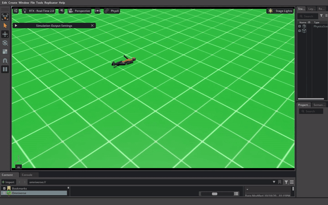
</p>

Gym id: `Isaac-Asimov1-FallRecovery-v0`. Separate task from standing/walking above - starts from a random fallen pose (full random SO(3) orientation, random position, small velocity jitter) and has to reach a genuine standing pose on its own: lying down -> sit upright -> kneel -> stand. Plain PPO, no AMP (no reference getup motion clip exists for this asset).

No stock Isaac Lab fall-recovery/getup template existed to build from (unlike walking, which had H1/G1/Spot precedent) - this was built from first principles plus literature (HumanUP arXiv:2502.12152, HoST arXiv:2502.08378) and, partway through, by directly comparing against a real working implementation: `openhorizon-labs/asimov-v1-policies`, a separate open-source project training the same getup task on the same robot in mjlab/MuJoCo Warp. Their design (an assist-force curriculum - an upward lift on the pelvis that decays as measured success rate rises, inspired by HoST's own "vertical pulling force" trick - plus their specific PPO hyperparameters) is the single biggest factor that got this checkpoint working, ported into Isaac Lab's own event-manager/wrench-composer APIs.

**17 training runs total**. Runs 1-13 (plain PPO, 1500 iterations each, fresh restarts) progressively diagnosed and fixed: an "A-pose" local optimum (robot using its head as a tripod leg, runs 1-7), a sitting-waypoint plateau that a hard hand-leverage exploit kept re-triggering (runs 8-10), and a dwell-too-long-while-seated problem (runs 11-13) - each fix verified via a dry-run -> headless smoke test -> 300-iteration headless check pipeline before trusting it on a real run, catching 2 real reward-hacking exploits and 2 structural reward-shape bugs along the way. Runs 14-17 switched to OpenHorizon-matched PPO settings (`entropy_coef` 0->0.005, `obs_normalization` False->True, `learning_rate` 5e-4->1e-3) plus a contact-pattern reward (`feet_only_contact`, rewards the specific pattern of "both feet touching, pelvis not" once near standing height) and a hand-pushoff bonus, then stayed on ONE resumed lineage across all 4 runs (14->15->16->17, 15996 total iterations, never restarted fresh) - this combination of a longer/higher-exploration training budget with the assist-force curriculum is what actually broke through: **success rate went from 0% (zero genuine successes across runs 1-13) to 89% by the end of run 17, with the assist-force curriculum fully decayed to 0.0 (the policy succeeds completely unassisted)**.

**Checkpoints included**:
- `asimov1_fallrecovery_validated.pt` - end of the runs14-17 lineage (iteration 15996), 89% success rate (own one-step standing check), fully unassisted. **All checkpoints in this task are trained with `obs_normalization=True`** - see each one's own `metadata.json` and the safetensors/ONNX section above for what that means for deployment (short version: use `actor.safetensors`, not `actor.onnx`, until the normalizer is baked into the ONNX export too).
- `asimov1_fallrecovery_posealign_validated.pt` - 4 further resumed runs on top of the checkpoint above (21493 total iterations). Drove the policy-stitching phase-machine's RECOVER->WALK success rate from 65.7% up to 88.0% (see its own `metadata.json` for the full per-run story, including a reward-shape change that measurably REGRESSED the rate before being corrected).
- `asimov1_fallrecovery_stable_validated.pt` - the current best, 3 more resumed runs (27490 total iterations, see its own `metadata.json` `reward_shape_lineage`). Driven by a new per-handoff joint-position diagnostic (`play_asimov1_phase_stitch.py --joint_diag_log`) that logs the full 23-joint vector at every real handoff, tagged with its outcome - found and fixed a hip_roll LEFT-RIGHT asymmetry (z-score up to +14.9 vs. the success population) and added a continuous-foot-contact bonus (targeting observed foot-tapping/body-wiggling after recovery). Handoff success: 88.0% -> 89.4% -> 90.0%. A third attempt (pulling the knee-bend value toward the walking policy's own target) engaged during training but did NOT change the actual knee value at the handoff instant - see Known open items below.

Run it live:
```bash
./isaaclab.sh -p scripts/reinforcement_learning/rsl_rl/play_asimov1_fallrecovery.py \
    --checkpoint /path/to/asimov1_fallrecovery_stable_validated.pt --num_envs 16 --viz kit
```

**Known open items**: not yet tested on real hardware or against the stricter multi-session visual-review bar other checkpoints in this repo were held to before being called "validated" - call this a strong training-time result, not a fully closed-out milestone yet. The knee-bend value at the exact RECOVER->WALK handoff instant stays near-straight (~0.0 rad) despite a direct, confirmed-engaging reward term penalizing deviation from the walking policy's own bent-knee target (0.38/-0.38) - two reward-shape attempts and one phase-machine-timing experiment (a longer pre-handoff settle requirement, which got the robot stuck instead of helping, see the phase-stitch section below) all failed to move this specific value, though none regressed the aggregate handoff rate either. A dedicated "sustained low angular velocity" reward term is the next untried idea if closing this gap becomes a priority.

## asimov-1: policy-stitching phase machine (walk -> fall -> recover -> walk)

Chains the walking and fall-recovery checkpoints into one continuous live loop in a single simulated robot: walk, get pushed over, detect the fall, recover, resume walking. A sensor-gated state machine (not a learned transition), mirroring the pattern `openhorizon-labs/asimov-v1-policies` (a separate project, same robot) proved in sim.

Run it live:
```bash
./isaaclab.sh -p scripts/reinforcement_learning/rsl_rl/play_asimov1_phase_stitch.py \
    --walk_checkpoint /path/to/asimov1_omni_robustness_validated/actor.safetensors \
    --recovery_checkpoint /path/to/asimov1_fallrecovery_stable_validated/actor.safetensors \
    --status_port 8800 --auto_push_interval_s 20 --viz kit
```
Status/control while running: `curl localhost:8800/status`, `curl -X POST localhost:8800/control/push`, `curl -X POST localhost:8800/control/reset`.

Add `--joint_diag_log /path/to/file.jsonl` to log the full 23-joint position vector at every RECOVER->WALK handoff, tagged with its eventual outcome (SUCCESS/FAIL) - the diagnostic tool that drove most of this project's recovery-policy fixes. Written with an explicit flush after every record, so it survives even a hard kill and is NOT subject to the stdout-buffering caveat below.

**Status**: **90.0% measured RECOVER->WALK handoff success** (36/40 in the latest validation window), up from an initial 65.7% baseline. Progression across several sessions of fixes, each one isolated and measured before moving to the next:
- Wrong action scale (0.5, not 0.25 - a different policy's value from the design brief this was built from) and a harmful action-blend at the handoff (averaging a standing-pose target with a gait-pose target produces a weak, indecisive intermediate command) - fixing both got the chain working at all, ~3-4/5.
- Two cheap phase-machine tweaks (zeroing joint velocity at the handoff, ramping the walk command instead of commanding full speed instantly) - measured essentially no effect (65.4%/65.7%, within noise). Useful negative result: ruled out the phase-machine's own gates as the remaining bottleneck, since gate-value comparisons (height/upright/ang_speed) showed zero separation between successful and failed handoffs.
- Retraining the WALKING policy for startup-state robustness (see its own section above) - also measured no effect on this specific number (65.4%), despite being a real, working fix for a genuine blind spot. Confirmed the walking policy wasn't the bottleneck either.
- Retraining the FALL-RECOVERY policy (see its own section above, several increments across two sessions) - this is what actually moved the number, 65.7% -> 80.0% -> (one regression, rolled back) -> 88.0% -> 89.4% -> **90.0%**. The deciding insight: good and bad handoffs were statistically indistinguishable at the root-body level the phase machine gates on, so the real gap had to be in the exact final joint configuration - confirmed directly via the `--joint_diag_log` diagnostic above, which found a specific hip_roll left-right asymmetry (fixed) and a persistent foot-tapping/wiggling pattern (also fixed, via a continuous-contact reward).

The training-time gravity-lift assist mechanism (environment-level, not part of either checkpoint) is explicitly forced off for this demo (confirmed via direct source read that it only ever decays downward, never resets up, so this override is safe for the whole run) - it's also now a permanent no-op from iteration 0 of training itself, confirmed no longer needed.

**A measurement bug was found and fixed along the way, worth knowing about if you build on this script**: the plain `print()`-based `[phase_stitch] t=...` transition log can silently lose data on long runs (800+ seconds) under stdout's default full-buffering when redirected to a file - confirmed by cross-checking its own transition count against the `--joint_diag_log` file's independently, explicitly-flushed record count on the same real run (one case: 41 counted in the log vs. 47 actually written). Fixed via `sys.stdout.reconfigure(line_buffering=True)` right after `AppLauncher` construction. If computing a success rate from this script's own output, prefer the `--joint_diag_log` file's record count over the printed transition log's count, especially for long collection windows.

**Known open items**: the knee-bend value at the exact handoff instant (see the fall-recovery section above) remains unresolved - a zero-retraining experiment raising the phase-machine's own `STAND_HOLD_TICKS` (from a 3-tick debounce to 20, to let the robot settle longer before handing off) made things WORSE, not better - the robot got stuck in RECOVER for 100+ seconds, because its residual angular velocity at the terminal pose is bursty/intermittent rather than a smooth settle, so requiring many consecutive low-velocity ticks just waits for an increasingly unlikely streak. Reverted back to 3. The remaining ~10% of handoffs that still fail show no single shared cause in the diagnostic data collected so far.

**Known open items**: the 2 remaining failures in the latest measurement were both quick re-falls (0.2-0.6s) with no shared cause found yet. A per-joint diagnostic (log the full 23-joint position vector at every handoff, success vs fail) is the natural next step if closing that last gap becomes a priority.

## asimov-1: go-to-point navigation (v0 FSM)

<p align="center">
  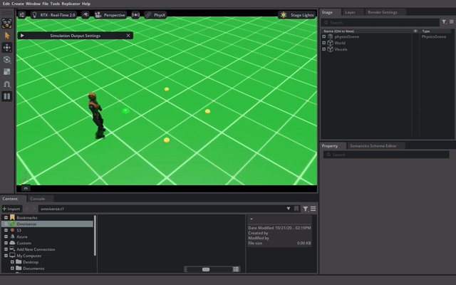
</p>

A supervisor FSM (`asimov1_phase_stitch/goto.py`) that steers the walking policy's own velocity-command interface toward a queue of world-frame `(x, y)` waypoints, arriving within `ARRIVAL_RADIUS_M` before advancing to the next. This is a deliberate **v0**: an orient-then-move proportional pursuit controller (architecture "(a)" from arXiv:2508.14098, "No More Marching"), not a trained end-to-end goal policy - every command it emits traces to two numbers (distance, heading error) and this one file, so its failure mode is bounded by its own clamps (worst case: a slow robot that stops) rather than a new checkpoint's unexplored edge cases. A trained goal-conditioned policy (v1) is meant to run *inside* this same supervisor later, not replace it.

Heading error drives a continuous forward-speed taper plus an explicit slew-rate limit on the command itself (not a hard orient/move threshold switch) - an early version's hard cutoff caused whipsaw turn-command reversals and spin-type falls near the threshold. The current goal (and any queued ones) render live in the Kit viewport via `isaaclab.markers.VisualizationMarkers`, and the same status/control HTTP server used by the phase machine gets a `POST /control/goto {"waypoints": [[x,y], ...]}` route for setting/replacing the queue live.

Run it live with a waypoint queue:
```bash
./isaaclab.sh -p scripts/reinforcement_learning/rsl_rl/play_asimov1_phase_stitch.py \
    --walk_checkpoint /path/to/asimov1_omni_robustness_validated/actor.safetensors \
    --recovery_checkpoint /path/to/asimov1_fallrecovery_stable_validated/actor.safetensors \
    --goto "1.5,0.0;1.5,1.5;0.0,1.5;0.0,0.0" --viz kit
```

**A real training bug was found and fixed along the way.** Live testing against the v0 FSM surfaced a turning-quality ceiling no amount of FSM-side tuning could close (wide-radius overshoot on sharp turns), which pointed back at the underlying walking policy's own turning behavior. Investigating that turned up `InsufficientProgressTermination` silently working against turning since the term was first added: it measured a 2-second window's displacement against a commanded direction computed from the robot's *current* (window-close) heading instead of its *window-start* heading - for sustained turning this created a systematic mismatch that scored good turns as "insufficient progress." Fixed by snapshotting heading alongside position at each window's start; `insufficient_progress`'s rate dropped from ~65-68% to near 0% immediately. A smaller residual version of the same bug class (a proportionally-scaled-but-still-nonzero progress bar that a legitimate near-zero-command pivot turn could still fail) was fixed with a true dead-zone (`min_command_speed`). Also added a `TurnBiasedVelocityCommand` custom command term (75% of sampled episodes are turn-focused) and raised `track_ang_vel_z`'s reward weight (2.0 -> 6.0) to match the raw achieved-reward parity `track_lin_vel_xy` already had. Across several retraining chunks after these fixes: Mean reward 51 -> 132, `error_vel_yaw` 0.69 -> ~0.29 rad, zero falls, with the turning-reward/linear-reward ratio steadily closing. The GIF above is the direct payoff: a 4-waypoint square loop completed in ~40s with clean, tight turns and no circling/overshoot, where the pre-fix policy would swing wide past each corner.

## v1x1: training status

Gym ids: `Isaac-V1X1-v0` (single-vector walk toward a fixed target, solved), `Isaac-V1X1-Velocity-v0` (omnidirectional velocity-command walking, solved, drives the teleop bridge below).

v1x1 uses effort/torque control (`JointEffortActionCfg`) rather than position control, and trains with plain PPO (no AMP/reference motion).

**Checkpoints included**:
- `v1x1_SVwalk_final.pt` - the single-vector "walk toward a point" policy.
- `v1x1_omni_final.pt` - the omnidirectional velocity-command policy. This is the one the teleop bridge below is built for.

Drive it with a keyboard:
```bash
# terminal 1 (source ROS2 Jazzy first):
./isaaclab.sh -p scripts/reinforcement_learning/rsl_rl/play_v1x1_cmd_vel.py \
    --checkpoint /path/to/v1x1_omni_final.pt --num_envs 1

# terminal 2 (source ROS2 Jazzy first):
ros2 run teleop_twist_keyboard teleop_twist_keyboard
```

**Important axis quirk**: v1x1's real anatomical forward is local **+Y**, not +X (a quirk of this robot's own mount orientation) - `play_v1x1_cmd_vel.py` already handles the remap internally (`Twist.linear.x` -> v1x1's `lin_vel_y` slot, `Twist.linear.y` -> `lin_vel_x`), so standard keyboard teleop still feels correct (forward key drives it forward) - just don't assume the raw command-vector axes line up with ROS convention if you're reading `vel_command_b` directly elsewhere.

## BDX-R: training status

Gym id: `Bdxr-Velocity-Flat-v0` (train), `Bdxr-Velocity-Flat-Play-v0` (play). Built on Isaac Lab's own stock
`LocomotionVelocityRoughEnvCfg` base class (same one H1/G1 use), trained with plain PPO (no AMP/reference
motion). Terrain switched from the upstream repo's own multi-row rough-terrain generator to a flat plane, to
match asimov-1/v1x1's own setup (same goal: walking, not rough-terrain generalization yet) and to spawn
environments in a tight, easy-to-view grid near the origin instead of scattered across a huge tiled map.

**Checkpoints included**:
- `bdxr_velocity_flat_validated.pt` - 1500 iterations from scratch, then resumed for 1500 more (2999 total) as
  a cleanup pass. Final: 100% success rate, ~84%/16% time_out/base_contact termination split, episode length
  ~930/1000 steps, velocity tracking error down to ~0.26 (xy) / ~0.24 (yaw).

Run it live:
```bash
./isaaclab.sh -p bdxr/scripts_rsl_rl/play.py \
    --task Bdxr-Velocity-Flat-Play-v0 --checkpoint /path/to/bdxr_velocity_flat_validated.pt --num_envs 50 --viz kit
```

**This upstream repo was written against a different Isaac Lab/rsl-rl-lib version than this repo is pinned
to** - getting it running against `v3.0.0-beta2.patch1` + the installed `rsl-rl-lib==5.0.1` required 6 real
compatibility fixes (all already applied in `bdxr/source_BDXR` and `bdxr/scripts_rsl_rl`, confirmed via direct
inspection, not guessed):
1. `isaaclab.utils.noise.AdditiveUniformNoiseCfg` renamed to `UniformNoiseCfg` in this pin.
2. `mdp.imu_projected_gravity` doesn't exist in this pin (no orientation on the `Imu` sensor data at all) -
   substituted the stock `mdp.projected_gravity`, which is exact here since this robot's IMU mount has a zero
   rotational offset.
3. A critic-only (not policy-facing) observation depending on a `JointWrenchSensor` type unavailable in this
   pin was dropped - zero effect on the deployed policy.
4. The `height_scanner`/`imu` sensors' hardcoded prim paths were missing a `/Geometry/` path segment that
   this URDF's on-the-fly conversion actually produces.
5. **The important one**: Isaac Lab's own `activate_contact_sensors()` helper only activates the PhysX
   contact-report API on the first rigid body it finds per branch - this URDF nests each leg link as a child
   of its parent link (mirroring the kinematic chain), so only `base_link` (1 of 11 bodies) was actually
   getting contact-sensed. Fixed by wrapping the robot's spawn function to re-walk the full tree and activate
   every rigid body, not just the first one - without this, every foot-contact-dependent reward term
   (air time, foot clearance, foot slip) would have had zero signal for 10 of 11 bodies.
6. The installed `rsl-rl-lib` (5.0.1) is two majors ahead of what `train.py`/`play.py` check for
   (`>=3.0.1`) - `isaaclab_rl.rsl_rl`'s own model-cfg classes leak deprecated fields into the actual model
   constructor unless `handle_deprecated_rsl_rl_cfg()` is called first, which neither script did by default.
   Patched both scripts to call it. **This would affect asimov-1/v1x1 too if either were retrained fresh
   against this same installed rsl-rl-lib version** - not just a BDX-R-specific issue.

## Microduck: VelStand (mjlab)

**Trained in mjlab (MuJoCo Warp), not Isaac Lab.** None of the Isaac Lab restore steps above apply. See [`microduck/velstand/README.md`](microduck/velstand/README.md) for the full card.

- **Current policy:** `microduck/velstand/velstand_round3_model_3999.onnx` (round 3). The round 2 (`velstand_remap_model_6750.onnx`) and round 1 (`velstand_model_3000.onnx`) policies are kept next to it for lineage.
- **How it was trained:** round 3 retrained both teachers. Walk v2 adds sharper speed and turn rewards so slow commands are no longer ignored; the stand teacher gained a penalty on trunk spin above 6 rad/s. VelStand then trained 4,000 iterations on both.
- **Measured:** in the CPU sim, 48/48 fallen starts got up and there were no falls in any walking test. The face-up rise peaks at 9.4 rad/s trunk spin (round 2: 13.6). Backing up (0.23 m/s at 0.20 asked), strafing (0.13 at 0.15) and slow right turns now work.
- **Known weaknesses, stated plainly:** 0.1 m/s commands and in-place turns of 0.4 rad/s or slower still do nothing. This policy is **sim only** and has never run on the physical robot.
- **Drive it** with plain `scripts/infer_policy.py --new-cmd-obs` from microduck_rl and the all-collisions scene (`scene_allcollisions.xml`).
- **License:** the policy files are CC-BY-NC-SA-4.0, my choice to match Pollen's terms for the Microduck 3D models. The config snapshots derive from Pollen's Apache-2.0 code and keep that license. Credit [Pollen Robotics](https://github.com/pollen-robotics/microduck_rl).

## Microduck: go-to-point navigation (v0 supervisor)

<p align="center">
  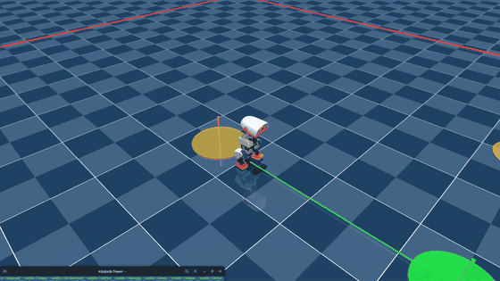
  <br>
  <em>Four-waypoint route, MuJoCo CPU viewer, 2x speed (30 s real time). Green = current goal, orange = queued, red = geofence.</em>
</p>

The asimov-1 go-to-point v0 pattern ported to the duck, with **no training**: a supervisor in [`microduck/goto_point/`](microduck/goto_point/README.md) drives the unchanged VelStand round 3 policy to a queue of `(x, y)` waypoints by writing only its velocity command.

- **Built around the duck's measured quirks.** It never commands a slow walk, because 0.10 m/s does nothing. It steers with forward arcs (turns track down to 0.1 rad/s while walking) and pivots in place only at 0.8 rad/s, since slower in-place turns are dead. It never strafes or backs up.
- **No separate recovery policy.** VelStand walks and gets up in one checkpoint, so the supervisor's whole fall response is to send zero until the duck is up, then carry on. asimov-1 needed a recovery policy and a phase machine for this.
- **Measured (headless CPU sim):** 10/10 single-point arrivals from random starts, a 4-waypoint chain in 30 s, a real mid-route fall followed by an unaided get-up and a completed route, and an out-of-arena waypoint rejected before motion.
- **Sim only**, using ground-truth pose. Arrival precision is about the 0.15 m radius.

## Microduck: BallKick v1 (right foot)

<p align="center">
  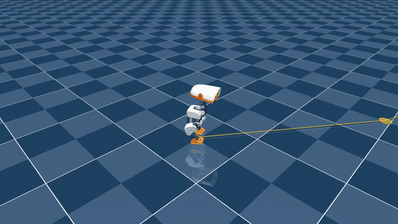
  <br>
  <em>One kick mission, MuJoCo CPU viewer, 1.5x speed. Green = stance spot, yellow = intended kick direction.</em>
</p>

A right-foot kick policy trained on Pollen's `Mjlab-BallKick-Flat-MicroDuck` task, plus a mission script in [`microduck/ballkick/`](microduck/ballkick/README.md). The mission walks to the ball with VelStand, lines the right foot up to ±12 mm, hard-swaps the kick policy in for 2 s, then swaps VelStand back.

- **The policy can't see the ball.** It kicks from one trained stance, so all the placement work is in the mission's aligner.
- **Measured (headless CPU sim, iteration 1000):** 50/50 kicks with the duck still standing, 50/50 through the VelStand → kick → VelStand handoff, 57/60 full missions, and 28/30 in a live 30-mission viewer run. No falls in any mission. Every failure was a ball bumped while lining up.
- **Known weaknesses:** kicks land about 15–18° left of the aim line (the mission now cancels this with a −17.9° aim offset; see PrecisionStep below) and about 1.6x harder than the 0.25 m/s target. It's right foot only. Later checkpoints overfit the start stance, so iteration 1000 ships and a wider-stance retrain is next.
- **Upstream note:** the task's target speed and reward weights disagree upstream. This run trained at 0.25 m/s through a fork-local env var; details are in the card.
- **Sim only.**
- **Superseded approach:** the PrecisionStep policy below now does the final approach (60/60 missions); the pulse aligner described here stays as its fallback.

## Microduck: PrecisionStep v1 (final approach)

<p align="center">
  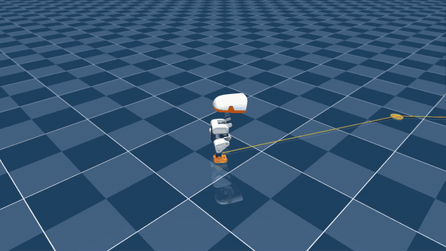
  <br>
  <em>Two missions, MuJoCo CPU viewer, real speed. VelStand walks in, PrecisionStep steps onto the green disk and stops, BallKick kicks.</em>
</p>

A third policy in the same hot-swap family, in [`microduck/precision_step/`](microduck/precision_step/README.md). It owns the last 25 cm before a kick: it steps onto the exact stance next to the ball and stops dead, feet level and legs back at the kick's start posture. The three twist slots carry the remaining offset to the target pose instead of a velocity.

- **Missions:** 60/60 headless and 30/30 in Dillon's live viewer run, with 0 bumped balls and 0 falls, against the pulse aligner's 57/60. Missions also got faster, about 18 s instead of 25 s.
- **Placement:** 50/50 kick-ready from a VelStand start (median 4.8 mm, 0.46°, legs within 3° of HOME), 49/50 with a 0.3 m/s push.
- **Trained** in a new fork-local task (`Mjlab-PrecisionStep-Flat-MicroDuck`) on the all-collisions robot, with the ball in the scene as an obstacle: touching it ends the episode.
- **Lesson on record:** the first run placed perfectly but arrived crouched, and the kick never fired (0/60). An arrival-posture term fixed it. The card has the details.
- **Mission calibrations (2026-11-11, no retraining):** two supervisor constants fix the remaining issues. A +10 mm stance shift brings the ball roll from 1.01 m back to 1.20 m. A −17.9° aim offset cancels BallKick's left drift, so kicks land at +0.1° median headless (−3.8 to +4.0°) and +0.5° in the viewer (30/30). Both are still 60/60 with 0 bumps and 0 falls.
- **Sim only.** The pulse aligner remains the named fallback.

## Microduck: BallKick v1 (left foot)

<p align="center">
  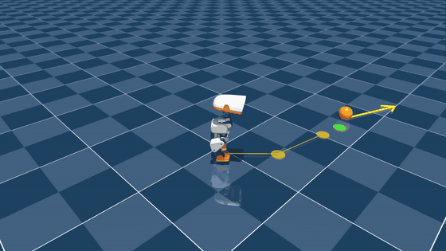
  <br>
  <em>A full left-foot mission, MuJoCo CPU viewer, real speed: VelStand walks in, PrecisionStep steps onto the green disk, the left foot kicks.</em>
</p>

The mirror of the right-foot kick, in [`microduck/ballkick_left/`](microduck/ballkick_left/README.md). It's the same Pollen task with the foot flag flipped, trained from scratch at the same 0.25 m/s target, and run through the same PrecisionStep mission with `--foot left`.

- **Missions (iteration 1250):** 60/60 headless and 30/30 in Dillon's live viewer, with 0 bumps and 0 falls. Kicks land at −0.2° median headless (−3.5 to +3.6°) and −0.5° in the viewer.
- **Battery:** 50/50 standing, 50/50 through the VelStand handoff, and 50/50 with a push at 1.0 s and at 3.5 s.
- **Its own calibrations, nothing inherited from the right foot:** this kick drifts about 11° *right*, so the mission aims it +11.2°. There's no stance shift: a +9 mm shift made PrecisionStep bump a left-side ball (2/60), and unshifted it already rolls 1.2 m.
- **Same overfitting as the right foot:** missions drop to 42/60 by iteration 1999, so 1250 ships.
- **Sim only.**

## A note on scope

This repo captures the training pipeline and validated checkpoints at a point in time - it's a backup/continuity snapshot, not a polished public release. Config comments throughout the included files document a lot of the reasoning (and dead ends) behind specific numeric choices; they're left in deliberately since they're often more useful than the code alone when picking this back up later.
