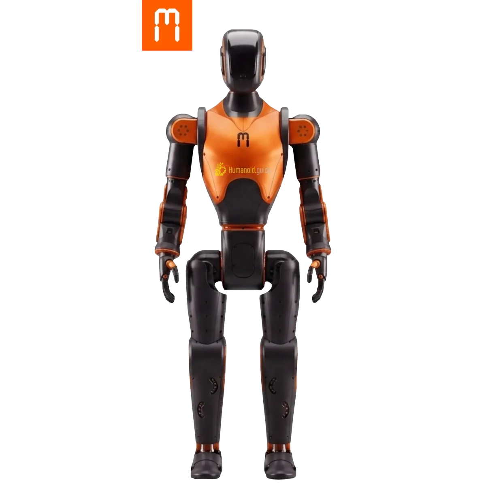
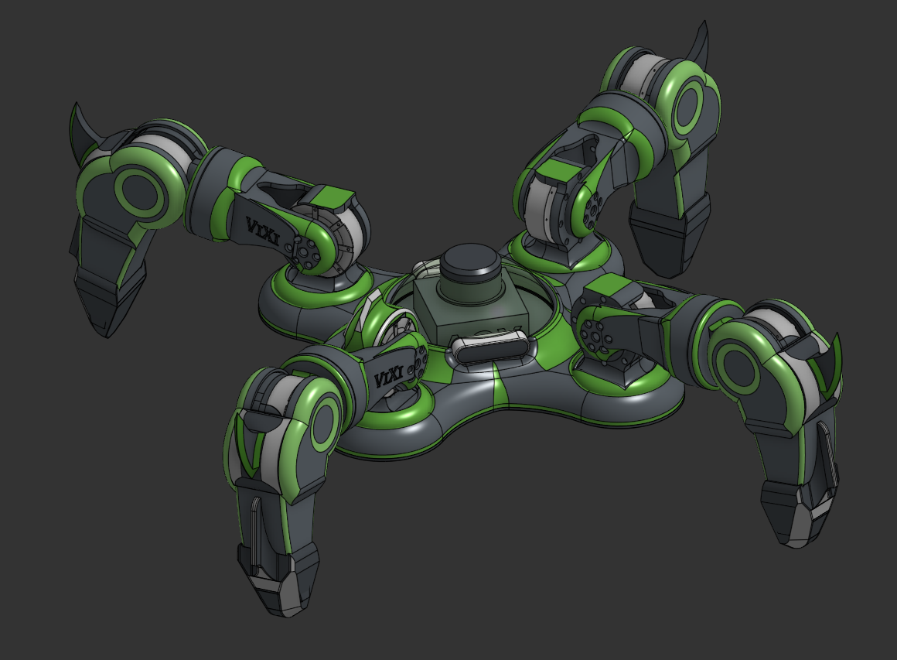
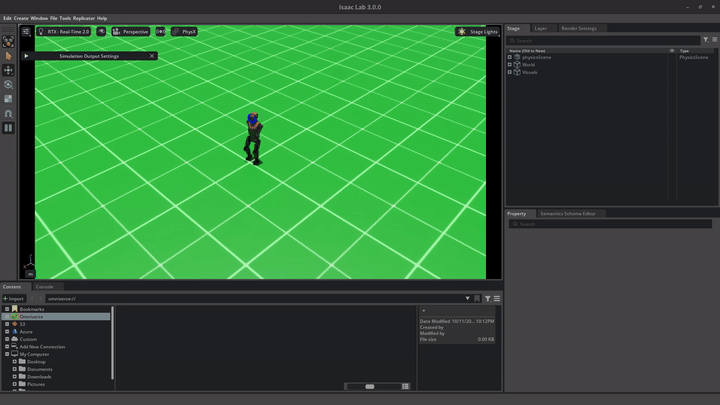

# H1V3-RobotPolicies

<p align="center">
  
  
</p>

<p align="center">
  
  <br>
  <em>asimov-1 driven live via the ROS2 /cmd_vel teleop bridge in this repo - proof of concept.</em>
</p>

Reinforcement learning locomotion policies trained in [NVIDIA Isaac Lab](https://github.com/isaac-sim/IsaacLab), covering two robots:

- **asimov-1** ([menloresearch/asimov-1](https://github.com/menloresearch/asimov-1)) - a 1.2m/35kg open-source humanoid. Trained with PPO + Adversarial Motion Priors (AMP) for omnidirectional walking (forward/backward/strafe/turn), with a live ROS2 teleop bridge for real-time keyboard control.
- **v1x1** - a custom quadruped. Trained with PPO for omnidirectional walking, also with a live ROS2 teleop bridge.

This repo does **not** contain the Isaac Lab framework itself - only the project-specific files (task definitions, reward/termination shaping, robot asset configs, converted USD models, training/play/teleop scripts, and a handful of validated checkpoints) needed to drop back into a fresh Isaac Lab checkout.

## Prerequisites

- **Isaac Lab**, checked out at tag **`v3.0.0-beta2.patch1`** (this is the exact version everything here was built and tested against - newer versions may have breaking API changes):
  ```bash
  git clone --branch v3.0.0-beta2.patch1 git@github.com:isaac-sim/IsaacLab.git
  ```
  Follow Isaac Lab's own install instructions to get it running (Isaac Sim + the IsaacLab Python environment).
- **ROS2 Jazzy** (only needed for the teleop bridge scripts):
  ```bash
  sudo apt install ros-jazzy-desktop ros-jazzy-teleop-twist-keyboard
  ```

## Restoring into a fresh Isaac Lab checkout

```bash
# from the root of a fresh IsaacLab clone:
rsync -a /path/to/H1V3-RobotPolicies/isaaclab/ ./
git apply /path/to/H1V3-RobotPolicies/isaaclab/patches/robot_registry_init.patch
```

The patch adds two export lines (`V1X1_CFG`, `ASIMOV1_CFG`) to `isaaclab_assets`'s own `__init__.pyi` stub files so both robots show up alongside Isaac Lab's built-in ones (`ANT_CFG`, etc.). If the patch doesn't apply cleanly against a different Isaac Lab version, just add the two lines by hand - see the patch file for exactly what's needed, it's trivial.

Checkpoints aren't wired into the `isaaclab/` tree (so you can put them wherever you like) - see `checkpoints/` below, and pass their path via `--checkpoint` on any of the play scripts.

## Repo layout

```
isaaclab/                    # mirrors Isaac Lab's own directory structure exactly
  scripts/reinforcement_learning/rsl_rl/
    train_asimov1_direct.py              # standing/balance task trainer
    train_asimov1_velocity_amp_direct.py # velocity-command (walking) task trainer, PPO+AMP
    train_asimov1_velocity_direct.py     # velocity-command task trainer, plain PPO (no AMP)
    play_asimov1_velocity_amp.py         # watch a checkpoint play back live (task's own random commands)
    play_asimov1_cmd_vel.py              # ROS2 /cmd_vel teleop bridge for asimov-1
    play_v1x1_cmd_vel.py                 # ROS2 /cmd_vel teleop bridge for v1x1
  source/isaaclab_assets/isaaclab_assets/robots/
    asimov1.py                # ASIMOV1_CFG articulation config (actuator gains, joint limits, etc.)
    v1x1.py                   # V1X1_CFG articulation config
  source/isaaclab_assets/data/Robots/
    asimov1/                  # converted USD robot model (incl. the orange/charcoal paint job + colors)
    v1x1/                     # converted USD robot model
  source/isaaclab_tasks/isaaclab_tasks/manager_based/classic/
    asimov1/                  # asimov-1's task definitions: env cfgs, mdp.py, AMP subpackage, agents/
    v1x1/                     # v1x1's task definitions: env cfgs, mdp.py, agents/
  patches/
    robot_registry_init.patch # the two __init__.pyi diffs described above

ros2_packages/
  v1x1_description/           # v1x1's own URDF/xacro, rviz configs, launch files (ROS2 package)
                               # NOTE: also lives at github.com/dillonfaulk/v1x1_description as its own repo,
                               # but the copy here includes a local fix (hardcoded mesh file paths updated
                               # from an old machine hostname) that wasn't committed/pushed there yet.

checkpoints/
  asimov1/                     # validated milestone checkpoints, see below
  v1x1/

tools/
  convert_checkpoint.py        # .pt -> safetensors + metadata.json converter, see below
```

## Safetensors conversions

Each checkpoint also has a same-named subfolder next to its `.pt` (e.g.
`checkpoints/asimov1/asimov1_omni_quality_run2_validated/`) containing:
- `actor.safetensors` - just the deployable policy network (no code, loads instantly, safe to open from an untrusted source - unlike `.pt`, which is pickle and can execute arbitrary code on load).
- `full.safetensors` - every tensor in the checkpoint (actor + critic + AMP discriminator where present), for continuing training or inspection.
- `metadata.json` - iteration, tensor shapes, source file hash, and obs/action dims. Confirmed for every checkpoint in this repo: no observation-normalization stats exist (`obs_normalization.type: "none"`) - training ran with `empirical_normalization=False`, so raw observations feed the policy directly. `command_ranges`/`control_hz`/`action_scale` are left `null` (task-config-specific, not auto-extracted - pull from the matching `*_env_cfg.py` in `isaaclab/` if needed).

Regenerate with:
```bash
./isaaclab.sh -p tools/convert_checkpoint.py checkpoints/<robot>/<name>.pt \
    --out checkpoints/<robot>/<name> --robot <robot> --isaac-lab v3.0.0-beta2.patch1 --run <name>
```

## asimov-1: training status

Gym ids: `Isaac-Asimov1-Stand-v0` (standing/balance, solved), `Isaac-Asimov1-Velocity-v0` (plain PPO walking), `Isaac-Asimov1-Velocity-AMP-v0` (PPO+AMP walking, the main line of work).

The AMP variant uses a real reference motion clip from Menlo's own training repo (`menloresearch/cyclotron`) - a discriminator learns to distinguish "real walking frame" from "policy-generated frame," and the policy is rewarded for fooling it, on top of the usual velocity-tracking task reward.

**Checkpoints included** (all for `Isaac-Asimov1-Velocity-AMP-v0`):
- `asimov1_omni_step3_validated.pt` / `asimov1_omni_step4_validated.pt` - successive checkpoints from a curriculum that gradually widened the commandable velocity range from forward-only up toward full omnidirectional, each validated over multiple training runs before widening further.
- `asimov1_omni_quality_run2_validated.pt` - the current best: same omnidirectional range, with an additional tuning pass for gait smoothness/accuracy (stronger action-smoothness and upright-orientation penalties, calibrated against this project's own logged reward magnitudes rather than copied blindly from any reference, plus new per-joint pose-tolerance, foot-stumble, and foot-contact-force-limit reward terms). This is the checkpoint that drove a live ROS2 keyboard teleop test successfully.

Run it live:
```bash
./isaaclab.sh -p scripts/reinforcement_learning/rsl_rl/play_asimov1_velocity_amp.py \
    --checkpoint /path/to/asimov1_omni_quality_run2_validated.pt --num_envs 16 --viz kit
```

Drive it with a keyboard:
```bash
# terminal 1 (source ROS2 Jazzy first):
./isaaclab.sh -p scripts/reinforcement_learning/rsl_rl/play_asimov1_cmd_vel.py \
    --checkpoint /path/to/asimov1_omni_quality_run2_validated.pt --num_envs 1 --viz kit

# terminal 2 (source ROS2 Jazzy first):
ros2 run teleop_twist_keyboard teleop_twist_keyboard
```
asimov-1's real forward axis is local +X (matches ROS `Twist.linear.x` directly, no axis remapping needed).

**Known open items** (as of this checkpoint): the commandable velocity range is close to, but not yet at, the full range asimov-1's original creators (Menlo) report using (`lin_vel_x=+/-0.8`, `lin_vel_y=+/-0.6` m/s) - widening the remaining gap is a deliberately paused task in favor of a gait-quality tuning pass first. A dedicated fall-recovery policy and a sit-to-stand/chair policy are both reasonable next projects once walking quality is fully settled.

**Important note if touching this asset's visuals**: the robot's materials use Isaac Lab's native instancing (`instanceable=true`) for GPU efficiency across many cloned training environments. USD's instancing rules mean a shared `material:binding` pointing outside a prim's own instanceable subtree gets **silently dropped** at composition time - editing the shared `AsimovGreen`/`AsimovGrey` material definitions has zero effect on the render. Recoloring must be done via each mesh prim's own `displayColor` attribute instead (a plain per-mesh value, not a cross-prim binding, so it isn't subject to the same rule).

## v1x1: training status

Gym ids: `Isaac-V1X1-v0` (single-vector walk toward a fixed target, solved), `Isaac-V1X1-Velocity-v0` (omnidirectional velocity-command walking, solved, drives the teleop bridge below).

v1x1 uses effort/torque control (`JointEffortActionCfg`) rather than position control, and trains with plain PPO (no AMP/reference motion).

**Checkpoints included**:
- `v1x1_SVwalk_final.pt` - the single-vector "walk toward a point" policy.
- `v1x1_omni_final.pt` - the omnidirectional velocity-command policy. This is the one the teleop bridge below is built for.

Drive it with a keyboard:
```bash
# terminal 1 (source ROS2 Jazzy first):
./isaaclab.sh -p scripts/reinforcement_learning/rsl_rl/play_v1x1_cmd_vel.py \
    --checkpoint /path/to/v1x1_omni_final.pt --num_envs 1

# terminal 2 (source ROS2 Jazzy first):
ros2 run teleop_twist_keyboard teleop_twist_keyboard
```

**Important axis quirk**: v1x1's real anatomical forward is local **+Y**, not +X (a quirk of this robot's own mount orientation) - `play_v1x1_cmd_vel.py` already handles the remap internally (`Twist.linear.x` -> v1x1's `lin_vel_y` slot, `Twist.linear.y` -> `lin_vel_x`), so standard keyboard teleop still feels correct (forward key drives it forward) - just don't assume the raw command-vector axes line up with ROS convention if you're reading `vel_command_b` directly elsewhere.

## A note on scope

This repo captures the training pipeline and validated checkpoints at a point in time - it's a backup/continuity snapshot, not a polished public release. Config comments throughout the included files document a lot of the reasoning (and dead ends) behind specific numeric choices; they're left in deliberately since they're often more useful than the code alone when picking this back up later.
