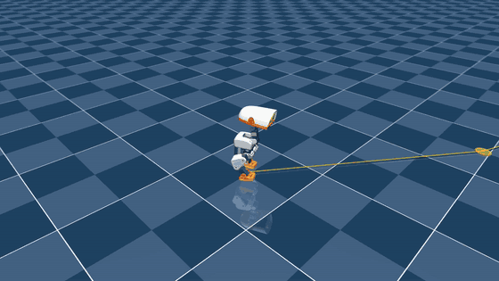

# Microduck BallKick v1 (right foot)

A policy that kicks a ball with the right foot, plus a mission script. The script walks the duck to the ball with the VelStand round 3 policy, lines it up, swaps in the kick policy for 2 s, then swaps VelStand back in. **Sim only**; nothing here has run on the physical robot.

<p align="center">
  
  <br>
  <em>One mission in the MuJoCo CPU viewer at 1.5x speed. Orange line = planned route, green disk = where the duck must stand, yellow arrow = intended kick direction.</em>
</p>

## The policy

| | |
|---|---|
| File | `ballkick_right_ts0p25_model_1000.onnx` |
| Task | `Mjlab-BallKick-Flat-MicroDuck`, `KICK_FOOT = "right"` |
| Checkpoint | iteration 1000 of a 4096-env run (chosen on eval, see below) |
| Contract | `[1, 61]` → `[1, 14]`, 50 Hz, normalizer baked in. Same observation layout as VelStand, with the 13 command inputs held at zero. |
| Ball target speed | **0.25 m/s**, set with `MICRODUCK_BALL_TARGET_SPEED=0.25` (see the note below) |
| ONNX check | max abs diff vs the PyTorch actor 1.2e-6 over 200 random inputs |

**The actor can't see the ball.** It learned one kick from one stance: the ball 0.09 m ahead and 0.042 m right of the trunk, with ±15 mm of noise. Only the critic saw the ball during training. Placing the duck is the mission script's job.

**Why the target speed is an env var.** Upstream commit `2a0b1b08` set `BALL_TARGET_SPEED` back to 1.0 but kept the reward weights (12 / −4) that `a3fb8635` had sized for 0.25. That makes the reward at the target about +12 per step instead of the documented ~+3. The fork reads `MICRODUCK_BALL_TARGET_SPEED` and defaults to the upstream 1.0. Both targets were trained in parallel, and 0.25 transferred better into missions (29/30 vs 18/30 at iteration 1000). `config/env.yaml` records the 0.25 this run used.

## Why iteration 1000

The kick itself stays good all the way through training. What degrades is how forgiving it is about where the duck stands: later checkpoints overfit the training start stance (joint noise ±0.05) and stop kicking from the slightly off stances a real walk-in produces.

| ts0.25 checkpoint | 1000 | 1500 | 2000 | 2500 | 3000 |
|---|---|---|---|---|---|
| Missions kicked (seed 0, 30 runs) | **29/30** | 15/30 | 12/30 | 5/30 | 4/30 |

The last checkpoint, 3500, still kicks 49/50 in the battery but only 11/60 in missions. The 1.0 m/s run is better at its end (3250: 33/60) but weaker at 1000 (18/30).

## Measured, iteration 1000 (headless CPU sim, all-collisions robot)

Settings match the VelStand eval harness: BAM actuator model, 1-step action delay, training solver settings.

| Test | Result |
|---|---|
| Kick battery, 50 episodes | **50/50 kicked, 50/50 standing.** Ball 0.375 m/s median (1.5x target), rolls 1.28 m, direction error 8.7° median |
| Handoff: VelStand stands 1.5 s → kick → VelStand back at 2.0 s | **50/50** kicked and standing |
| 0.3 m/s push at 1.0 s / at 3.5 s | **50/50** / **48/50** (2 falls) |
| Full missions, 2 × 30 random balls 1.0–1.8 m away, random kick directions | **57/60 kicked, 0 falls.** All 3 failures were the duck bumping the ball while lining up. |
| Live viewer, 30 missions back to back | **28/30 kicked, 0 missed, 0 falls.** 2 aborts from a bump. Ball 0.46 m/s, 1.26 m, about 23 s per mission. |

Every mission that lined up kicked the ball. The raw results are in [`results/`](results/): battery CSVs, push and handoff summaries, and the event logs plus tally from the viewer run.

## The mission (`code/kick_mission.py`)

1. **Navigate:** the [go-to-point](../goto_point/) supervisor, unchanged, walks to a point behind the ball on the kick line. If the straight path would pass within 0.25 m of the ball, it detours around it.
2. **Align:** stop-and-settle pulses until the ball sits at the trained offset from the **right foot** (not the trunk) within ±12 mm sideways and 3° of heading.
   - The forward window is lopsided, −20 to +12 mm, because the kick tolerates a ball up to 30 mm too close but starts missing past +20 mm.
   - The pulse sizes come from VelStand's measured responses. A pivot is about 0.8° per tick. Forward is quantized: under 10 ticks the duck just twists in place, 15 ticks is one 25–38 mm step.
   - If a pulse stalls, the next one on that axis is made longer.
   - If the ball is close and a big correction is needed, the duck backs off and walks in again (at most twice), so a strafe can't sweep the foot through the ball.
3. **Square up:** if the right foot isn't level with the left, a short strafe pair resets the stance before the swap.
4. **Kick:** hard ONNX swap into the kick policy using the same 61-D observation buffer, held 2 s.
5. **Settle:** swap back to VelStand at zero command. If the duck falls, it sends zero until it's back up.

**Ball-rolling guard:** if the ball moves before the kick, the duck waits for it to stop and plans again. If the ball still hasn't stopped after 6 s, the mission ends with `BALL_LOST`. The sim ball has almost no rolling resistance.

**Clamps differ from go-to-point:** inside the align zone (0.30 m of the stance) the mission allows |vx| ≤ 0.2, |vy| ≤ 0.15 and |wz| ≤ 1.0. Go-to-point's forward-only, no-strafe clamps can't place the duck to ±15 mm.

**Events:** `MISSION_START`, `ALIGN_*`, `BALL_DISTURBED` / `BALL_SETTLED` / `BALL_LOST`, `KICK_SWAP_IN`, `KICK_FIRE`, `KICK_SWAP_OUT`, `MISSION_DONE`, plus the go-to-point events.

## Run it (from the microduck_rl repo root)

```bash
# live viewer, 30 missions back to back; terminal keys: N = new ball, P = push, Q = quit
uv run python scripts/kick_mission.py <velstand_round3_model_3999.onnx> <ballkick_right_ts0p25_model_1000.onnx> \
  --viewer --auto 30

# headless batch -> logs/kick_mission/<stamp>/
uv run python scripts/kick_mission.py <velstand.onnx> <ballkick.onnx> --runs 30 --seed 0

# kick battery: kick policy alone, then VelStand stand -> kick -> VelStand
uv run python scripts/kick_battery.py <ballkick.onnx> --target 0.25 --episodes 50
uv run python scripts/kick_battery.py <ballkick.onnx> --target 0.25 --scene allcollisions_ball \
  --prestand <velstand.onnx> --handoff <velstand.onnx>    # add --push-at 1.0 for a push
```

`kick_mission.py` imports `infer_policy.py`, `goto_point.py` and `goto_supervisor.py` from microduck_rl's `scripts/`. It needs `scene_allcollisions_ball.xml` in `src/mjlab_microduck/robot/microduck/`.

## Files

| Path | What it is |
|---|---|
| `ballkick_right_ts0p25_model_1000.onnx` | The kick policy |
| `metadata.json` | Hashes, contract, training settings, measured results |
| `config/` | Task config (with the env-var override), plus the run's `agent.yaml` and `env.yaml` |
| `code/` | Mission and battery scripts, the all-collisions ball scene, unit tests (aligner logic; cfg override and the ball-blind 61-D actor) |
| `results/` | Battery, handoff and push results for iteration 1000; event logs and tally from the 30-mission viewer run |

`code/` and `config/` are a snapshot of [dillonfaulk/microduck_rl @ local/velstand-own-teachers](https://github.com/dillonfaulk/microduck_rl/tree/local/velstand-own-teachers), commits `c1edc0e7` (code) and `0eb1a226` (both training runs, every checkpoint, all evals).

## Known limits

- **Kicks drift about 15° left of the intended line** in missions, and they do it consistently. A fixed aim offset in the mission would cancel most of it.
- **Too strong:** the ball leaves at about 1.6x the 0.25 m/s target.
- **Narrow stance tolerance.** The duck has to be placed within about ±15 mm, and most of a mission's 23 s goes to lining up. A retrain with wider start-stance randomization is the planned v2.
- **Right foot only.**
- **Sim only, ground-truth ball and pose.**

## License and attribution

The policy file is CC-BY-NC-SA-4.0, matching the VelStand policies here. The task config, the scene and the training stack come from [pollen-robotics/microduck_rl](https://github.com/pollen-robotics/microduck_rl) under Apache-2.0 (see `LICENSE_UPSTREAM_APACHE-2.0`). The mission and battery scripts are original to this project. Credit Pollen Robotics for the robot, the BallKick task and the training stack.
