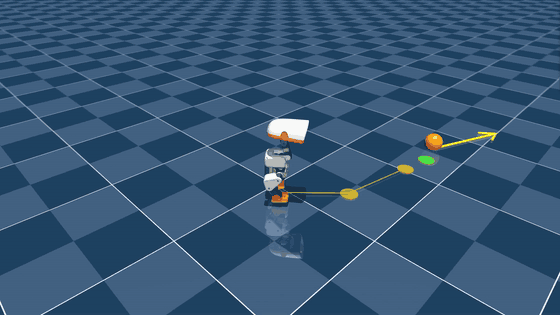

# Microduck BallKick v1 (left foot)

The left-foot mirror of [BallKick v1 (right foot)](../ballkick/README.md). It's the same task with the foot flag flipped, trained from scratch as a separate policy, then run through the same mission (VelStand walks in, [PrecisionStep](../precision_step/README.md) steps onto the stance, this policy kicks, VelStand takes back over). With both feet done, the kick family is complete. **Sim only**; nothing here has run on the physical robot.

<p align="center">
  
  <br>
  <em>A full left-foot mission in the MuJoCo CPU viewer at real speed, after the end of the previous one. VelStand walks the orange route, PrecisionStep steps onto the green disk, and the left foot kicks along the yellow arrow.</em>
</p>

## Results

| Full missions (navigate → precision step → kick → recover), iteration 1250 | Left foot | Right foot (reference) |
|---|---|---|
| Kicked, 2 × 30 headless, calibrated | **60/60** | 60/60 |
| Kicked, live viewer, 30 back to back | **30/30** | 30/30 |
| Bumped balls / falls | 0 / 0 | 0 / 0 |
| Kick direction vs the intended line, headless (median, range) | **−0.2°** (−3.5 to +3.6) | +0.1° (−3.8 to +4.0) |
| Kick direction, viewer | −0.5° (−6 to +3), 26/30 within 2° | +0.5° (−5 to +3) |
| Ball roll, median | 1.21 m headless, 1.26 m viewer | 1.20 m |
| Peak ball speed vs the 0.25 m/s target | 0.44 m/s (1.8×) | 0.46–0.49 m/s |
| Median mission time | 17.7 s | 17.8 s |

**Kick battery** (50 episodes each, kick policy only, ball at the trained spot ±15 mm):

| Test | Result |
|---|---|
| Standing start | **50/50** kicked and still standing; peak 0.36 m/s (1.4×) |
| 1.5 s of VelStand standing → kick → VelStand back at 2 s (as in a mission) | **50/50**; peak 0.41 m/s (1.6×) |
| 0.3 m/s push at 1.0 s / at 3.5 s | **50/50 / 50/50** (right foot: 50/50 / 48/50) |
| Stay-up rate | 100%: no falls in any battery or mission at this checkpoint |

## The policy

| | |
|---|---|
| File | `ballkick_left_ts0p25_model_1250.onnx` |
| Task | `Mjlab-BallKick-Flat-MicroDuck` with `KICK_FOOT = "left"` (set with `MICRODUCK_KICK_FOOT=left`, a fork-local env var) |
| Checkpoint | iteration 1250 of a 2,000-iteration, 4,096-env run, trained from scratch on GPU0 (~6.5 GB) |
| Ball target speed | **0.25 m/s** (`MICRODUCK_BALL_TARGET_SPEED=0.25`), the same as the right-foot winner |
| Contract | `[1, 61]` → `[1, 14]`, 50 Hz, normalizer baked in. Same layout as VelStand, with the 13 command inputs held at zero. |
| Ball | at (0.09, **+0.042**) m in the trunk yaw frame, ±15 mm: in front of the left toe. The right leg is the support leg. |
| ONNX check | max abs diff vs the PyTorch actor 1.9e-6 over 1,000 random inputs (`code/verify_onnx.py`) |

**The actor can't see the ball**, like the right foot. Placing the duck is the mission's job.

**Every penalty term logged ≤ 0** on every readout, iterations 0–1999.

## Why iteration 1250

The left foot overfits the same way the right one did. The kick stays good in the battery all the way through training, but later checkpoints stop kicking from the slightly-off stances a real walk-in produces.

| Checkpoint (missions uncalibrated, 2 × 30) | 750 | 1000 | **1250** | 1500 | 1750 | 1999 |
|---|---|---|---|---|---|---|
| Missions kicked | 60/60 | 60/60 | **60/60** | 60/60 | 55/60 | 42/60 |
| Ball roll, median | 1.04 m | 1.17 m | **1.19 m** | 1.09 m | 0.94 m | 1.21 m |
| Kick direction (median; std) | −10.5° | −12.3°; 1.9° | **−11.2°; 1.3°** | −13.5° | −12.1° | −18.1° |
| Battery, stand + handoff | 50/50 | 50/50 | **50/50** | 49/50 | 49/50 | 49/50 |

1250 has the steadiest drift, which is what a single aim constant needs, and it was 50/50 in every battery. 1000 is a close second. Per-checkpoint details are in `results/eval_2026-11-12/SUMMARY.txt`.

## Mission calibrations (measured on this checkpoint, nothing inherited from the right foot)

Run the mission with `--foot left`. The right foot keeps its own constants (+10 mm, −17.9°).

| Constant | Left value | How it was set |
|---|---|---|
| Stance shift (`PRECISE_STANCE_SHIFT_M["left"]`, env `KICK_STANCE_SHIFT_LEFT`) | **0 mm** | Unshifted, the ball sits +9.4 mm farther than trained from the left foot, but it already rolls 1.19 m with 0 bumps. A +9 mm shift was tested and **rejected**: 58/60, with 2 bumped balls. PrecisionStep's stepping foot clipped the ball on the way in, because it only ever trained with the ball on the right side. |
| Aim offset (`KICK_AIM_OFFSET["left"]`, env `KICK_AIM_OFFSET_DEG_LEFT`) | **+11.2°** | This kick drifts **right**, −11.2° median (std 1.3°, IQR −12.3 to −10.3, flat across ball distance: −11.7 / −11.1 / −11.0°). +yaw is left, so the offset is positive and the duck aims left. |

**The drift is a property of this policy.** The kicks land about 11° right of the trunk heading, a mirror of the right foot's ~18° left, but smaller. The offset is a mission calibration of it.

## Run it (from the microduck_rl repo root)

```bash
V=logs/rsl_rl/velstand/2026-11-03_10-56-19_round3/velstand_round3_model_3999.onnx
K=<ballkick_left_ts0p25_model_1250.onnx>
P=<precision_step_model_3999.onnx>

# live viewer, 30 missions; terminal keys: N = new ball, P = push, Q = quit
uv run python scripts/kick_mission.py $V $K --foot left --precision $P --viewer --auto 30

# headless missions -> logs/kick_mission/<stamp>/
uv run python scripts/kick_mission.py $V $K --foot left --precision $P --runs 30 --seed 0

# kick battery (add --prestand $V --handoff $V, or --push-at 1.0)
uv run python scripts/kick_battery.py $K --foot left --target 0.25 --episodes 50

# train it again
MICRODUCK_KICK_FOOT=left MICRODUCK_BALL_TARGET_SPEED=0.25 uv run train Mjlab-BallKick-Flat-MicroDuck \
  --env.scene.num-envs 4096 --agent.max-iterations 2000 --video True
```

## Files

| Path | What it is |
|---|---|
| `ballkick_left_ts0p25_model_1250.onnx` | The policy |
| `metadata.json` | Hashes, contract, training settings, measured results, calibrations |
| `config/` | The task config (with the `MICRODUCK_KICK_FOOT` env var) and the run's `agent.yaml` / `env.yaml` (which record `0.042` and `0.25`) |
| `code/` | `kick_mission.py` (`--foot`; supersedes the copies in `../ballkick/code/` and `../precision_step/code/`), `kick_battery.py` (`--foot`, signed drift), `mission_stats.py`, `verify_onnx.py`, cfg tests |
| `results/eval_2026-11-12/` | `SUMMARY.txt` (every checkpoint), plus the 1000/1250 batteries, pushes, and the uncalibrated, +9 mm and +11.2° mission runs |
| `results/viewer_auto30_2026-11-12/` | Dillon's 30/30 viewer run: event logs and tally |

`code/` and `config/` are a snapshot of [dillonfaulk/microduck_rl @ local/velstand-own-teachers](https://github.com/dillonfaulk/microduck_rl/tree/local/velstand-own-teachers), commits `f3fab128` (left-foot tooling), `41ac224f` (left calibrations) and `d040a8e0` (the run, every checkpoint, all evals).

## Known limits

- **Too strong:** 0.41–0.45 m/s in missions against the 0.25 m/s target (1.6–1.8×), about the same as the right foot. Both feet's overshoot is the input for BallKick v2.
- **The ball sits ~9 mm farther than trained** from the left foot. The stance can't move closer with PrecisionStep v1 without bumping the ball, so the kick tolerates it instead. [PrecisionStep v2](../precision_step_v2/README.md) (2026-11-13) removes that limit: 60/60 at +9 mm with 0 bumps. The aim at +9 mm hasn't been recalibrated yet (kicks land about 5° right).
- **Narrow start-stance tolerance** in later checkpoints, the same overfitting as the right foot. A wider start-stance retrain is the planned v2.
- **Sim only, ground-truth ball and pose.**

## License and attribution

The policy file is CC-BY-NC-SA-4.0, matching the other Microduck policies here. The task, robot and training stack are [pollen-robotics/microduck_rl](https://github.com/pollen-robotics/microduck_rl) (Apache-2.0, see `LICENSE_UPSTREAM_APACHE-2.0`). The only fork-local changes the training used are the `MICRODUCK_KICK_FOOT` and `MICRODUCK_BALL_TARGET_SPEED` env vars. Credit Pollen Robotics.
