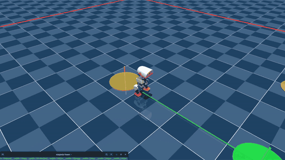

# Microduck go-to-point (v0 supervisor)

**No training, no new policy.** A deterministic supervisor that drives the existing VelStand round 3 policy ([`../velstand/velstand_round3_model_3999.onnx`](../velstand/)) to a queue of world-frame `(x, y)` waypoints. It's the same v0 pattern as the asimov-1 go-to-point in this repo: navigation logic lives outside the learned policy, and the policy stays a velocity tracker. **Sim only**; nothing here has run on the physical robot.

<p align="center">
  
  <br>
  <em>Four-waypoint route in the MuJoCo CPU viewer, played at 2x speed. Green disk = current goal (sized to the 0.15 m arrival radius), orange = queued, red line = arena geofence. The route takes 30 s in real time.</em>
</p>

## How it works

Every 50 Hz control tick the supervisor reads the duck's pose, puts the active waypoint into the duck's own frame, and writes only the policy's three twist inputs (vx, vy, wz). The head and body pose inputs stay at zero, so the policy contract is unchanged.

The control law is shaped around round 3's measured command response:

| Round 3 behavior (CPU sim) | Supervisor design |
|---|---|
| Walking speed is a step: 0.10 m/s does nothing, ~0.13 walks | Speed is always 0 or 0.20 m/s. Arrival cuts straight to zero inside the radius, never a slow taper. |
| While walking, turns track down to 0.1 rad/s (right turns run ~25% hot) | Steering is a forward arc: wz = 1.5 x heading error, capped at 1.0 rad/s. |
| Turning in place does nothing at 0.4 rad/s or slower, works from 0.6 | In-place pivots use 0.8 rad/s, only when the goal is more than 60° off or too close to the side to arc to. They stop below 20°. |
| Strafing is weak, backing up curves | Paths are forward only, with no sideways command. |
| Zero command means "stand", and the policy gets up on its own | If the duck falls, the supervisor sends zero until it has been upright for 1 s, then resumes the same waypoint. |

The supervisor also has the safety layer from the asimov-1 design:
- **Geofence:** waypoints outside the arena are rejected before any motion.
- **Command clamps:** vx 0 to 0.25, vy 0, |wz| up to 1.0, applied in one place.
- **Watchdog:** a pose older than 200 ms forces zero. This is unit-tested; in the sim the pose read can't stall, so it hasn't fired in a live run.
- **E-stop:** holds zero while engaged.
- **Event log:** `GO_TO_START`, `GO_TO_ARRIVE`, `GO_TO_REJECT`, `FALL`, `RECOVERED`, plus a 1 Hz trace.

The pose comes from simulator ground truth in v0. On hardware, the same supervisor would take the robot's onboard odometry instead.

## Measured (headless CPU sim, 2026-11-08)

Settings match the VelStand eval harness: BAM actuator model, 1-step action delay, training solver settings, all-collisions scene.

| Test | Result |
|---|---|
| Single point: 10 random starts, headings and goal bearings (0.6–2.0 m, including goals behind) | **10/10 arrived** in 4–9 s, 0 falls |
| Chain: (1.2, 0) → (1.2, 1) → (2.2, 1.3) → back to (0, 0) | **4/4 in 30 s**, markers cleared in order, 0 falls |
| Mid-route fall: sideways push at 0.8 m into a 2-waypoint route | Real fall (109° tilt, trunk at 58 mm). Zero command the whole time it was down, **got up by itself**, route completed. |
| Geofence: waypoint at x = 4 in a ±2.5 m arena | **Rejected before motion**, the other two completed |

The duck stops about 13 cm from each goal (radius 0.15 m), with no overshoot. Per-leg commanded-vs-achieved tracking is printed by the suite. Turns in place track (0.8 commanded, 0.85–0.92 achieved), and right arcs overshoot their command (−0.20 commanded → −0.31 achieved), which the closed loop absorbs.

The event logs for every test and for the recorded viewer drive are in [`results/`](results/). The full 50 Hz command traces are in the microduck_rl fork under `logs/goto/`.

## Files

| Path | What it is |
|---|---|
| `code/goto_supervisor.py` | The supervisor: pure logic, no simulator code |
| `code/goto_point.py` | Runner: headless acceptance suite and live viewer with waypoint markers |
| `code/test_goto_supervisor.py` | 10 unit tests (clamps, no-creep, arrival, geofence, pivot hysteresis, orbit check, fall rule, watchdog, e-stop) |
| `results/` | Event logs (jsonl) from the acceptance run and the recorded drive |

`code/` is a snapshot of [dillonfaulk/microduck_rl @ local/velstand-own-teachers](https://github.com/dillonfaulk/microduck_rl/tree/local/velstand-own-teachers), commit `758aeb5c`, where these files live in `scripts/` and `tests/`. Run them from there: `goto_point.py` imports microduck_rl's `scripts/infer_policy.py`.

## Run it (from the microduck_rl repo root)

```bash
# live viewer; keys in the terminal: P = push, SPACE = e-stop, Q = quit
uv run python scripts/goto_point.py /path/to/velstand_round3_model_3999.onnx \
  --viewer --waypoints "1.2,0;1.2,1;2.2,1.3;0,0"

# headless acceptance suite -> logs/goto/<stamp>_all/
uv run python scripts/goto_point.py /path/to/velstand_round3_model_3999.onnx --suite all
```

Waypoints are world-frame metres: x points straight ahead of the duck's starting heading, y to its left. `--arena xmin,xmax,ymin,ymax` sets the geofence (default ±2.5 m).

## Known limits

- **Arrival precision is about the radius.** The duck stops at the edge of the 0.15 m circle. Finer stops need slow-speed walking, which runs into round 3's 0.10–0.15 m/s dead zone. The fix for that dead zone is already scoped separately (a lookup-table floor plus a short training chunk).
- **No final heading.** The duck arrives facing wherever its approach left it.
- **Sim only, ground-truth pose.** No odometry or obstacle handling yet.

## License and attribution

The supervisor and runner are original to this project. They run inside [pollen-robotics/microduck_rl](https://github.com/pollen-robotics/microduck_rl) (Apache-2.0) and drive a policy released here under CC-BY-NC-SA-4.0 (see [`../velstand/README.md`](../velstand/README.md)). Credit Pollen Robotics for the robot and training stack.
