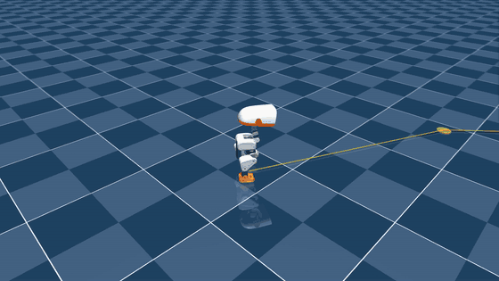

# Microduck PrecisionStep v1

A policy that takes over the last stretch before a kick. It steps from up to 25 cm away onto an exact stance next to the ball, stops dead with the feet level and the legs back at the kick's start posture, then hands over to the [BallKick](../ballkick/) policy. It replaces the BallKick mission's pulse aligner, which stays in the code as the fallback. **Sim only**; nothing here has run on the physical robot.

<p align="center">
  
  <br>
  <em>Two missions in the MuJoCo CPU viewer at real speed. VelStand walks the orange route, PrecisionStep steps in to the green disk and stops, BallKick kicks along the yellow arrow.</em>
</p>

## Results

The mission test uses the same random balls and kick directions (seeds 0 and 1) as the pulse aligner's published numbers.

| Full missions (navigate → final approach → kick → recover) | Pulse aligner | **PrecisionStep** |
|---|---|---|
| Kicked, 2 × 30 headless | 57/60 | **60/60** |
| Kicked, live viewer, 30 back to back | 28/30 | **30/30** |
| Bumped balls (the old aligner's only failure) | 3 | **0** |
| Falls | 0 | 0 |
| Median mission time | ~25 s | **~17–19 s** |
| Fell back to the pulse aligner | n/a | 0 |

**Placement battery** (50 episodes each; random targets from the training distribution, ball at the kick spot whenever it fits):

| Start | Kick-ready | Position error (median / worst) | Heading | Worst leg joint vs HOME | Ball struck | Falls |
|---|---|---|---|---|---|---|
| After 1.5 s of VelStand standing (as in the mission) | **50/50** | 4.8 / 9.4 mm | 0.46° | 3.0° | 0/46 | 0 |
| Training-like start | **49/50** | 4.7 / 7.9 mm | — | 3.0° | 1/40 | 1 |
| VelStand start + 0.3 m/s push at 1 s | **49/50** | 4.0 / 6.8 mm | — | 2.7° | 1/46 | 0 |

**Kick-ready** means all of these: within 12 mm and 3° of the target, feet within 10 mm of level front-to-back, still for the last 0.5 s, every leg joint within 0.10 rad of HOME, ball not moved, no fall. Across the three batteries, 130/132 episodes with a ball and 18/18 without one were kick-ready.

## The policy

| | |
|---|---|
| File | `precision_step_model_3999.onnx` |
| Task | `Mjlab-PrecisionStep-Flat-MicroDuck` (new, in the fork; not upstream) |
| Contract | `[1, 61]` → `[1, 14]`, 50 Hz, normalizer baked in. Same layout as VelStand and BallKick, so all three hot-swap. |
| Command | Slots 48–50 carry the **remaining offset to the target pose** in the trunk's current yaw frame: `[dx m, dy m, dyaw rad]`, recomputed every tick. Head/body slots are zero. Trained up to 0.25 m and ±15°. |
| ONNX check | max abs diff vs the PyTorch actor 8.3e-7 |

**The same three slots mean different things to different policies.** VelStand reads slots 48–50 as a velocity; this policy reads them as an offset. The supervisor picks which ONNX runs, so it fills the slots to match. microduck_rl already does this for the sit/stand policy, whose posture flag lives in the vx slot.

**The policy can't see the ball.** The ball's position is implied by the target: the target stance is the one that puts the ball at the kick spot.

## How it was trained

- **Episodic, BallKick-style.** Each 6 s episode starts standing (HOME ±0.08 rad joint noise, wider than BallKick's ±0.05, which overfit) with one random target: mostly under 80 mm, a tail to 250 mm, half in a forward cone, ±15° heading, and 10% "hold still".
- **The ball is an obstacle.** In 70% of episodes it sits at the BallKick spot relative to the *target* stance. Moving it more than 1 cm ends the episode with a penalty. The other 30% train plain step-to-pose.
- **Rewards:** two-scale position/heading Gaussians, potential-based progress (pays approach, charges retreat, can't be farmed by holding still), a "settled" term (on target, both feet down, trunk still), penalties for foot stagger near the target, overshooting the target, and striking the ball, and an **arrival posture** term (legs at HOME within 30 mm of the target).
- **All-collisions robot**, the model VelStand trains on and the mission runs on. BallKick trains on the ground-contact model.
- **2,048 envs** (4,096 would not fit a 16 GB card), PPO, 4,000 iterations in two chunks.

**Why the arrival-posture term exists.** Run 1, iteration 1000, already placed the duck to 4.5 mm, but it arrived in a deep crouch, with hips about 30° and knees about 36° off HOME. The kick only ever trained from HOME ±3°, so it fired **0/60** missions, even with the ball moved to the exact spot from the foot. Run 2 resumed from run 1's iteration 1250 with the posture terms added. By iteration 2000 the crouch was down to about 4° and missions went 60/60. The lesson: an arrival stance has to be the next policy's start stance.

## In the mission (`code/kick_mission.py --precision <onnx>`)

1. **Navigate** with the go-to-point supervisor, as before.
2. **Pivot (VelStand)** onto the kick line if the heading is more than 8° off, since the step policy trained on ±15°.
3. **Precise:** hard swap to this policy and feed it the remaining offset to the stance pose every tick. It's done when within 12 mm and 3° and still for 0.5 s.
4. **Kick:** swap to BallKick for 2 s, then back to VelStand.

**Fallback:** a 6 s timeout or a fall swaps VelStand back in, and the pulse aligner finishes the approach. A bumped ball re-enters the precision step at most twice. Every mission logs its `approach_mode` (`precision`, `precision->pulse fallback`, or `pulse`) and the worst leg-joint deviation at the kick swap. All reported numbers are `precision` mode; the fallback never triggered.

## Mission calibrations (2026-11-11)

These are two supervisor constants in `kick_mission.py`. Neither one retrains or changes any policy. They were measured in order, on the same 60 headless scenarios as v1 (seeds 0 and 1), because the aim has to be calibrated against the stance it will kick from.

| Constant | Value | Why |
|---|---|---|
| `PRECISE_STANCE_SHIFT_M` (env `KICK_STANCE_SHIFT`) | **+0.010 m** along the kick line | The policy parks the trunk on target, but its feet end ~5 mm behind HOME. So, measured from the kicking foot, the ball sat +10.2 mm farther than the kick trained on. Only the precision path uses this; the pulse fallback keeps its own foot-relative target. |
| `KICK_AIM_OFFSET` (env `KICK_AIM_OFFSET_DEG`) | **−17.9°** | Cancels BallKick v1's left drift. +yaw is left, so the duck faces 17.9° right of the intended line. The kick result and the viewer's yellow arrow are still measured against the intended line. Right foot only. |

| 60 missions, seeds 0+1 | v1 | + stance shift | + aim offset |
|---|---|---|---|
| Kicked / bumped / falls | 60 / 0 / 0 | 60 / 0 / 0 | 60 / 0 / 0 |
| Ball vs trained spot, from the kicking foot (median) | +10.2 mm | +0.25 mm | +0.5 mm |
| Ball roll, median (range) | 1.01 m (0.76–1.30) | **1.20 m** (1.02–1.38) | 1.20 m (1.04–1.37) |
| Kick direction, + = left (median, range) | +15.5° (11.2–19.3) | +17.9° (13.4–21.2) | **+0.1°** (−3.8 to +4.0) |
| Worst leg joint vs HOME / mission time | 3.0° / 17.7 s | 3.0° / 17.7 s | 3.1° / 17.8 s |

**Notes:**
- **Stance shift:** 59 of 60 missions rolled farther. One rolled 3.4 cm less than its own v1 run. None rolled less than v1's shortest (0.76 m). The pulse aligner's matching measurement is 1.22 m.
- **Drift is a constant:** std 1.7°, and 17.9 / 17.4 / 17.9° across the three ball-distance bands. That's why a single constant is the fix.
- **Order matters:** moving the stance moved the drift from 15.5° to 17.9°.
- **Dillon's viewer run with both constants:** 30/30 kicked, all precision, 0 falls. Kick direction median +0.5°, range −5 to +3°, 28/30 within 2°. Ball roll median 1.19 m (1.10–1.31).

Logs are in `results/calibration_2026-11-11/`. Commits are `0cdcc030` (stance shift), `e3ea0569` (aim offset) and `27007cd7` (viewer run). `code/mission_stats.py` produces these summaries.

## Run it (from the microduck_rl repo root)

```bash
V=logs/rsl_rl/velstand/2026-11-03_10-56-19_round3/velstand_round3_model_3999.onnx
K=<ballkick_right_ts0p25_model_1000.onnx>
P=<precision_step_model_3999.onnx>

# live viewer, 30 missions; terminal keys: N = new ball, P = push, Q = quit
uv run python scripts/kick_mission.py $V $K --precision $P --viewer --auto 30

# headless missions -> logs/kick_mission/<stamp>/
uv run python scripts/kick_mission.py $V $K --precision $P --runs 30 --seed 0

# placement battery (add --push-at 1.0 for a push)
uv run python scripts/step_battery.py $P --episodes 50 --prestand $V
```

## Files

| Path | What it is |
|---|---|
| `precision_step_model_3999.onnx` | The policy |
| `metadata.json` | Hashes, contract, training settings, measured results |
| `config/` | Task config, the run's `agent.yaml` / `env.yaml`, and an extract of the PrecisionStep section of `mdp.py` |
| `code/` | `kick_mission.py` (with `--precision` and the 2026-11-11 calibrations; supersedes the copy in `../ballkick/code/`), `step_battery.py`, `mission_stats.py`, cfg tests |
| `results/eval_2026-11-11/` | Batteries and missions: `run2_m3999_*` (shipped), `run2_m2000_*`, and `run1_m1000_*` (the crouch) |
| `results/viewer_auto30_2026-11-11/` | Dillon's 30/30 viewer run: event logs and tally |
| `results/calibration_2026-11-11/` | Stance-shift and aim-offset missions (headless, seeds 0+1) and the viewer tally with both constants |

`code/` and `config/` are a snapshot of [dillonfaulk/microduck_rl @ local/velstand-own-teachers](https://github.com/dillonfaulk/microduck_rl/tree/local/velstand-own-teachers), commits `a74d061d` (code) and `16534d57` (both runs, every checkpoint, all evals).

## Known limits

- **Left-foot kicks work unchanged but with no stance shift (2026-11-12).** With the ball on the left (`--foot left`), it placed the duck for 450 left-foot missions across seven kick checkpoints (and the calibrated runs) with 0 bumps. Moving the stance target +9 mm closer made its stepping foot clip the ball (2/60), because it only ever trained with the ball on the right. See [`../ballkick_left/`](../ballkick_left/README.md).

- **The feet end about 5 mm behind HOME** relative to the trunk, so with the trained target the ball sat about 10 mm too far from the kicking foot. The mission compensates by moving the target +10 mm (see [Mission calibrations](#mission-calibrations-2026-11-11)). The policy itself is unchanged.
- **BallKick v1 kicks about 18° left** from this stance. The mission's −17.9° aim offset cancels it. The offset is right foot only, and a left-foot kick needs its own measurement.
- **Sim only, ground-truth pose and ball.**

## License and attribution

The policy file is CC-BY-NC-SA-4.0, matching the other Microduck policies here. The task is new in the fork but built on [pollen-robotics/microduck_rl](https://github.com/pollen-robotics/microduck_rl) (Apache-2.0, see `LICENSE_UPSTREAM_APACHE-2.0`): the robot, the training stack, and the BallKick task it copies its DR, observation and regularizer setup from. Credit Pollen Robotics.
