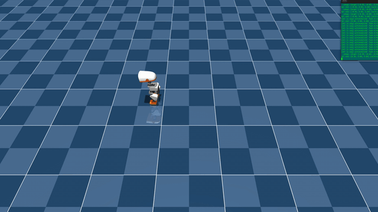

# Microduck VelStand (mjlab) — walks and gets up, one policy

**Trained in mjlab (MuJoCo Warp), not Isaac Lab.** Sim-validated only; this policy has never run on the physical robot.

Microduck is Pollen Robotics' ~800 g open-source biped. VelStand is a single policy that follows velocity commands and gets back up after a fall. It was trained with [pollen-robotics/microduck_rl](https://github.com/pollen-robotics/microduck_rl) using our own teachers. The full code, every training run and the eval scripts are in [dillonfaulk/microduck_rl @ local/velstand-own-teachers](https://github.com/dillonfaulk/microduck_rl/tree/local/velstand-own-teachers).

## Files

| File | What it is |
|---|---|
| `velstand_round3_model_3999.onnx` | **Current policy** (round 3, iteration 3999) |
| `velstand_remap_model_6750.onnx` | Round 2 (iteration 6750), kept for lineage |
| `velstand_model_3000.onnx` | Round 1 (iteration 3000), kept for lineage |
| `metadata.json` | Contract, lineage, checksums, measured results, known weaknesses |
| `config/microduck_velstand_env_cfg.py`, `config/distill.py`, `config/microduck_standup_env_cfg.py`, `config/microduck_velocity_env_cfg.py` | Task configs (VelStand, stand teacher, walk teacher) and the distillation code, from commit `25b011ef` (round 3). Earlier rounds' versions are in the git history. |
| `config/round3_run/`, `config/round2_remap_run/`, `config/chunk1_run/` | `agent.yaml` (RSL-RL PPO config) and `env.yaml`, exactly as each run saved them |

## Contract

- Observation `[1, 61]` → action `[1, 14]`, 50 Hz (physics 5 ms × decimation 4).
- The observation normalizer is **baked into the ONNX** (exported with microduck_rl's `scripts/export.py`). Feed raw observations. Each ONNX was checked against its PyTorch checkpoint (max difference about 1e-6 to 6e-6).
- The gravity input is **projected gravity**, not the raw accelerometer.

## Drive it (CPU MuJoCo viewer)

```bash
cd microduck_rl
uv run python scripts/infer_policy.py --new-cmd-obs \
  --scene src/mjlab_microduck/robot/microduck/scene_allcollisions.xml \
  --walking /path/to/velstand_round3_model_3999.onnx
```

<p align="center">
  
  <br>
  <em>Microduck VelStand driven live by keyboard in the MuJoCo viewer (mjlab-trained, sim only; recorded with the round 2 policy).</em>
</p>

The all-collisions scene is required: the policy trained with neck, head and upper-leg collisions. Don't use `logs/drive_remap.py`; that wrapper was calibrated for model_3000.

## How it was trained

1. **Rounds 1–2 → `model_6750`.** VelStand warm-started from our first velocity walk (`model_4750`), cloned our StandUp expert (`supportgate/model_3500`) on fallen frames and the walk on upright frames. The walk had speed dead zones, so round 2 fed it a command lookup table during training.
2. **Walk v2 (new walk teacher).** The first walk ignored slow commands because its speed reward was too forgiving at Microduck speeds: standing still at 0.1 m/s still earned 90% of it. Walk v2 was retrained from scratch with sharper speed and turn rewards added next to the stock ones (ramped in after the gait forms) and in-place turn commands down to 0.1 rad/s. 8,000 iterations → `model_7998`.
3. **Gentle stand teacher.** The StandUp expert was resumed with a penalty on trunk spin above 6 rad/s, introduced only after the get-up skill already existed. Face-up rises went from 13.7 to 9.7 rad/s peak with get-ups still 100% → `model_11000`.
4. **Round 3 → `model_3999`.** 4,000 iterations of VelStand on both new teachers, with a new lookup table measured on walk v2.

## Measured (round 3, model_3999)

| | Round 2 (`6750`) | **Round 3 (`3999`)** |
|---|---|---|
| CPU sim get-ups (48 fallen starts) | 46/48 | **48/48** |
| Training sim prone get-ups | 99.0 / 99.5% | **99.3 / 100%** |
| Face-up rise, peak trunk spin (median) | 13.6 rad/s | **9.4 rad/s** |
| Back 0.20 m/s (CPU / training sim) | 0.12 / 0.13 | **0.23 / 0.23** |
| Strafe (CPU 0.15 / training sim 0.10) | 0.08 / 0.03 | **0.13 / 0.11** |
| Turn right 0.5 rad/s (CPU) | 0 | **0.48** |
| Forward 0.30 m/s (CPU) | 0.26 | **0.31** |
| Turn ±1.0 rad/s (CPU) | 1.09 / −1.08 | 1.03 / −1.19 |

No falls in any walking test in either sim.

## Known weaknesses

- 0.10 m/s forward or backward does nothing. In the CPU sim, 0.15 m/s forward from a standstill also does nothing (it works in the training sim).
- Turns in place at 0.4 rad/s or slower do nothing; a left turn at 0.5 rad/s reaches only 0.29 in the CPU sim.
- Backing up still curves slightly in the CPU sim.
- Rising from a sitting start still peaks around 13 rad/s.

## License and attribution

Trained with [pollen-robotics/microduck_rl](https://github.com/pollen-robotics/microduck_rl) by Pollen Robotics. The upstream code is Apache-2.0, and the config snapshots in `config/` are derived from it and keep that license (see `LICENSE_UPSTREAM_APACHE-2.0`). Pollen's 3D mesh files (`.stl`) are CC-BY-NC-SA-4.0. None are included here, but the policies were trained in simulation on the robot those meshes describe.

**The policy files (`*.onnx`) are released under [CC-BY-NC-SA-4.0](https://creativecommons.org/licenses/by-nc-sa/4.0/).** That's my choice, matching the terms Pollen uses for the Microduck's 3D models; Pollen's licenses don't require it. Credit Pollen Robotics ([pollen-robotics/microduck_rl](https://github.com/pollen-robotics/microduck_rl)) and this repo, use them non-commercially only, and share adaptations under the same license.
